# GoMCP

[](https://github.com/StevenCyb/GoMCP/releases)
[](LICENSE)
[](go.mod)

Annotation-driven [MCP](https://modelcontextprotocol.io) server generator for
Go. Write plain handler functions, sprinkle `@MCP.*` comments on top, and
GoMCP generates a runnable `main` package serving a spec-compliant
Streamable HTTP MCP endpoint with tools, resources and prompts.

**Supported spec: MCP [2026-07-28](https://modelcontextprotocol.io/specification/2026-07-28)** — the stateless
revision (no sessions, no `initialize`, every request carries its protocol version and client capabilities).
Older revisions are not supported.

> **Status: v0.x.** The exported API of `pkg/mcp` may still change between minor versions. Requires Go 1.26.2 or newer.
> Release binaries for Windows are not tested yet. Code snippets in this document are abbreviated; runnable code is in [`example/`](example).

## See It In 5 Seconds

Write this in a Go module that requires GoMCP (`go get github.com/StevenCyb/GoMCP`):

```go
package api

import "github.com/StevenCyb/GoMCP/pkg/mcp"

type HelloIn struct {
	Name string `json:"name" desc:"Who to greet"`
}

// @MCP.Tool("hello", description="Greets someone")
func Hello(ctx mcp.Context, in HelloIn) (string, error) {
	return "Hello " + in.Name, nil
}
```

Run:

```sh
gomcp serve .
```

Get:

- A Streamable HTTP MCP endpoint at `/mcp` with `tools/list` and `tools/call`.
- Input and output schemas derived from your Go types.
- Auto-generated bootstrap (`main`, transport, auth, lifecycle wiring).

> A more advanced example for every feature is in the [example](example) directory.

## Install

```sh
go install github.com/StevenCyb/GoMCP/cmd/gomcp@latest
```

The binary is called `gomcp`.

## Contents

- [See It In 5 Seconds](#see-it-in-5-seconds)
- [Install](#install)
- [Basics](#basics)
  - [Annotation syntax](#annotation-syntax)
  - [How it runs](#how-it-runs)
- [CLI](#cli)
  - [build, serve and watch](#build-serve-and-watch)
  - [Flags and environment](#flags-and-environment)
- [Server](#server)
  - [Identity and instructions](#identity-and-instructions)
  - [Stateless requests](#stateless-requests)
  - [Transport settings](#transport-settings)
  - [Caching hints](#caching-hints)
  - [Middleware](#middleware)
  - [Setup and teardown](#setup-and-teardown)
  - [Static assets and icons](#static-assets-and-icons)
- [Authentication](#authentication)
  - [Bearer and API keys](#bearer-and-api-keys)
  - [OAuth resource server](#oauth-resource-server)
  - [Scopes](#scopes)
- [Tools](#tools)
  - [Defining a tool](#defining-a-tool)
  - [Hints, metadata and requirements](#hints-metadata-and-requirements)
  - [Results and errors](#results-and-errors)
  - [Asking the client](#asking-the-client)
  - [Form elicitation](#form-elicitation)
  - [URL elicitation](#url-elicitation)
  - [Sampling](#sampling)
  - [Roots](#roots)
  - [Progress and logs](#progress-and-logs)
  - [Long-running tasks](#long-running-tasks)
- [Resources](#resources)
  - [Static and templated resources](#static-and-templated-resources)
  - [Listing resources](#listing-resources)
  - [Change notifications](#change-notifications)
- [Prompts and completion](#prompts-and-completion)
  - [Prompts](#prompts)
  - [Completion](#completion)
- [Runtime](#runtime)
  - [Using pkg/mcp by hand](#using-pkgmcp-by-hand)
  - [Options](#options)
  - [Errors](#errors)
  - [What is automatic and what is not](#what-is-automatic-and-what-is-not)

## Basics

### Annotation syntax

Annotations are comment lines. One optional positional value, the rest is `key="value"`, `key=1` or a bare flag. The doc comment above is the description. Types in the signature become the JSON schemas.

```go
// Adds a short text note.
//
// @MCP.Tool("add_note", title="Add note")
// @MCP.AuthScopes("notes:write")
func Add(ctx mcp.Context, in AddIn) (Note, error) { ... }

type AddIn struct {
	Text string `json:"text" desc:"Note body" min:"1" max:"500"`        // required: no omitempty
	Tag  string `json:"tag,omitempty" enum:"work,idea" default:"idea"`  // optional
}
```

Struct tags: `desc enum min max default format`. A period at the end of an annotation line is ignored.

### How it runs

gomcp reads your annotations, generates a `main` package in memory, and builds it with `go build -overlay`, so nothing is written into your module.

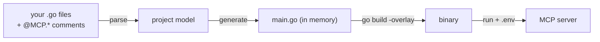

## CLI

### build, serve and watch

`build` compiles a single binary, `serve` builds and runs once, `watch` rebuilds and restarts on every `.go` change and keeps the old server if a rebuild fails.

```sh
gomcp build ./example ./bin/notes   # one binary
gomcp serve ./example               # build + run, Ctrl-C stops gracefully
gomcp watch ./example               # rebuild on change
gomcp version
```

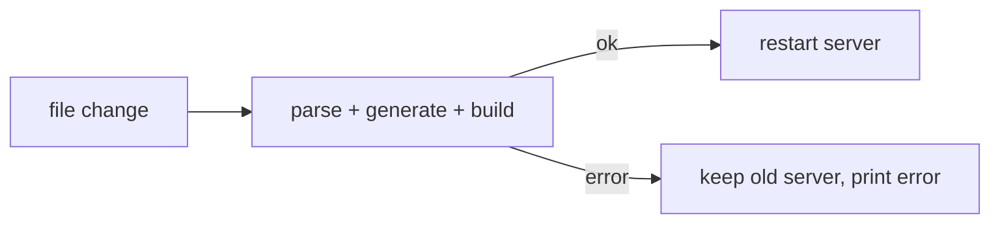

### Flags and environment

`--tags/-t` forwards build tags. `serve` and `watch` also take `--dotenv/-e` (default `<module>/.env`; real environment wins) and `--addr/-a` (sets `GOMCP_ADDR`, default `:8080`).

```sh
gomcp serve ./example --addr 127.0.0.1:8765 --dotenv ./dev.env
```

## Server

### Identity and instructions

Name, version and instructions of the server. Clients show the name and may add the instructions to the model's system prompt. Package-level, any comment block in the package.

```go
// @MCP.Server("notes", title="Notes", version="1.0.0", website="https://example.com")
// @MCP.Icon("assets/notes.svg")
// @MCP.Instructions("Use the notes tools to create and read short notes.")
package api
```

### Stateless requests

No sessions and no `initialize`. Every request carries the protocol version and the client's capabilities, so any instance can answer it. Headers `Mcp-Protocol-Version`, `Mcp-Method` and `Mcp-Name` mirror the body for gateways. Mismatch is `-32020`, unknown version `-32022`.

```go
// nothing to write: gomcp validates headers and _meta, and answers server/discover
```

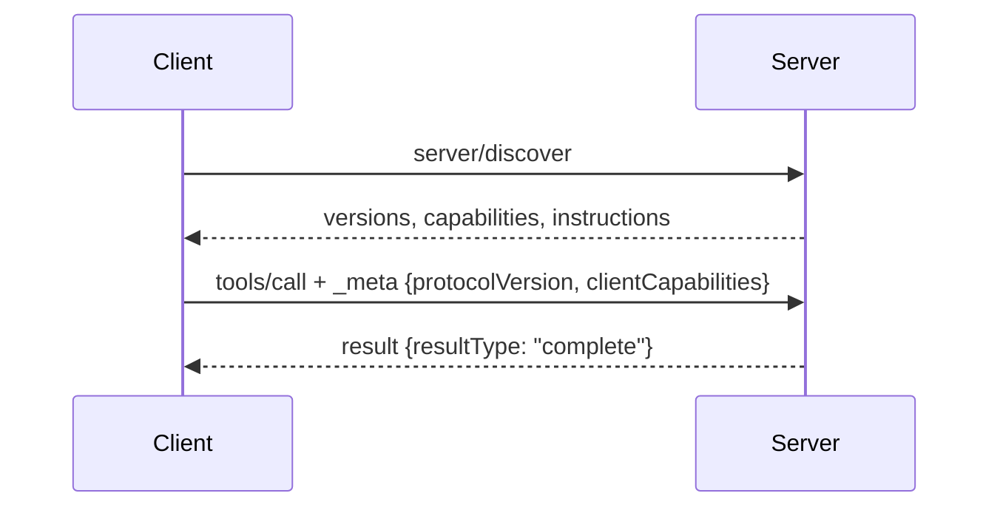

### Transport settings

One endpoint, POST only (GET and DELETE answer `405`). Origins are checked (`403`), lists are paged, listen streams get keep-alive comments.

```go
// @MCP.Endpoint("/mcp")
// @MCP.AllowedOrigin("https://claude.ai")
// @MCP.KeepAlive("30s")
// @MCP.PageSize(50)
package api
```

### Caching hints

Tells clients how long discover, list and read results may be reused (`ttlMs`) and by whom (`cacheScope`: `public` or `private`).

```go
// @MCP.Cache("5m", scope="private")
package api
```

### Middleware

Wraps calls for logging, metrics or rate limits. Declare with `@MCP.Middleware`, attach with `@MCP.Use(fn)` at package level (everything) or on one feature.

```go
// @MCP.Middleware
func Logging(ctx mcp.Context, req mcp.Request, next mcp.Handler) (any, error) {
	log.Printf("%s %s", req.Kind, req.Name)
	return next(ctx, req)
}
// package level: @MCP.Use(api.Logging)    on a feature: @MCP.Use(api.Logging)
```

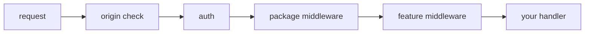

### Setup and teardown

Run code once when the server starts and stops, for example to open and close a database. `Setup` may return an error that stops the start.

```go
// @MCP.Setup
func Setup() error { db = open(); return nil }

// @MCP.Teardown
func Teardown() { db.Close() }
```

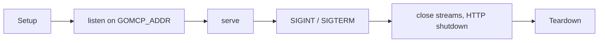

### Static assets and icons

Serve embedded files (icons, images) from the same server. Relative icon paths on any feature resolve to the served URL.

```go
// @MCP.ServeAssets("/assets")
//go:embed assets
var Assets embed.FS

// @MCP.Tool("add_note")
// @MCP.Icon("assets/add.svg")   // becomes http://host/assets/add.svg
```

## Authentication

### Bearer and API keys

For internal tokens and API keys: your verifier checks the token and returns the caller. Failure is a plain `401`. Several `@MCP.Auth` are allowed, the first success wins.

```go
// @MCP.Auth(type="bearer")
func VerifyAPIKey(ctx context.Context, token string) (mcp.Principal, error) {
	if token != os.Getenv("API_KEY") { return mcp.Principal{}, errors.New("invalid") }
	return mcp.Principal{Subject: "service", Scopes: []string{"notes:read"}}, nil
}
```

### OAuth resource server

gomcp verifies tokens, it never issues them. It serves the protected resource metadata, challenges unauthenticated calls and checks scopes. Needs `resource=`, an authorization server and scopes.

```go
// @MCP.Auth(type="oauth", resource="https://notes.example.com/mcp")
// @MCP.AuthServer("https://auth.example.com")
// @MCP.AuthScope("notes:read", description="Read notes", default)
func VerifyToken(ctx context.Context, token string) (mcp.Principal, error) { ... }
```

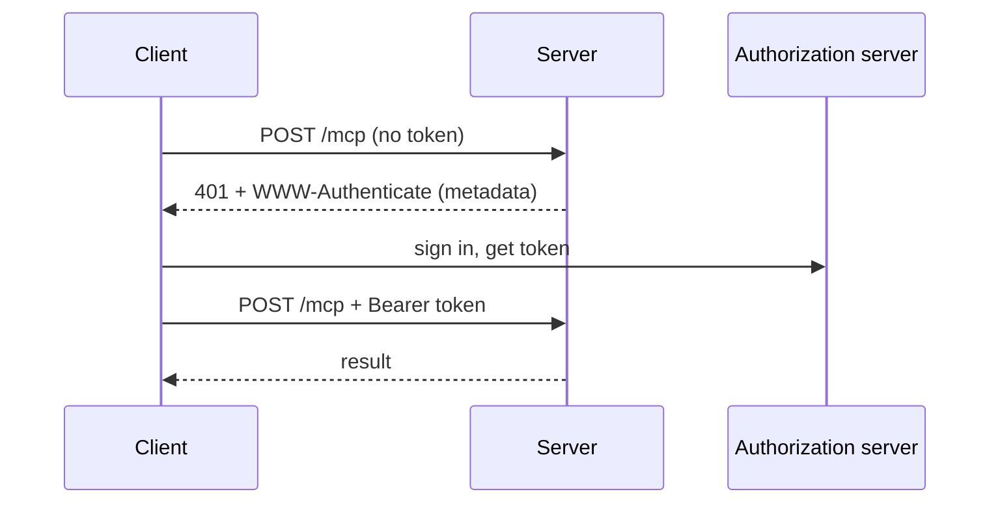

### Scopes

Limit a feature to callers with certain scopes. A missing scope gives `403 insufficient_scope`, so the client can ask the user for more permission. In handlers, `ctx.Principal()` is the caller.

```go
// @MCP.Tool("delete_note")
// @MCP.AuthScopes("notes:write")
func Delete(ctx mcp.Context, in IDIn) (mcp.Empty, error) {
	who := ctx.Principal().Subject
	...
}
```

## Tools

### Defining a tool

A tool lets the model do something. Input schema comes from the input struct; a struct result also gives an output schema. Invalid arguments become tool errors the model can fix itself.

```go
// @MCP.Tool("get_note", description="Returns a note by id")
func Get(ctx mcp.Context, in IDIn) (Note, error) { ... }   // func(ctx, In) (Out, error)
```

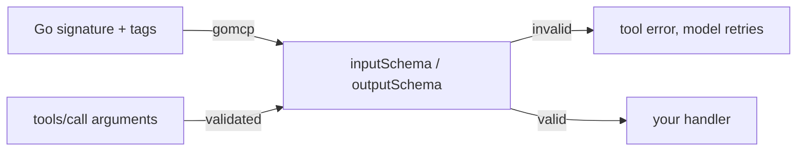

### Hints, metadata and requirements

Hints tell clients what a tool does (`readOnly`, `destructive`, `idempotent`, `openWorld`). `@MCP.Requires` names client capabilities the tool needs; without them the call fails early with `-32021`.

```go
// @MCP.Tool("delete_note")
// @MCP.Hint(destructive)
// @MCP.Requires(elicitation)          // also: sampling, roots, elicitation="url"
// @MCP.Meta(team="docs")
```

### Results and errors

Return a struct (structured + text), a string, or `mcp.Result[T]` to add content such as links. `mcp.ToolError` is shown to the model; protocol errors go to the client.

```go
func Get(ctx mcp.Context, in IDIn) (mcp.Result[Note], error) {
	n, ok := notes[in.ID]
	if !ok { return mcp.Result[Note]{}, mcp.ToolError("note not found") } // model sees it
	return mcp.Result[Note]{Structured: n, Content: []mcp.Content{mcp.ResourceLink("note:///" + n.ID)}}, nil
}
```

### Asking the client

The server cannot call the client. Calls that need an answer return `mcp.ErrInputRequired`: return it unchanged. gomcp sends `input_required`, the client answers and retries, and your handler runs again from the top with the answer. Ask first, act after.

```go
ans, action, err := mcp.Elicit[Confirm](ctx, "Delete it?")
if err != nil { return out, err }          // ErrInputRequired: gomcp asks, then reruns
```

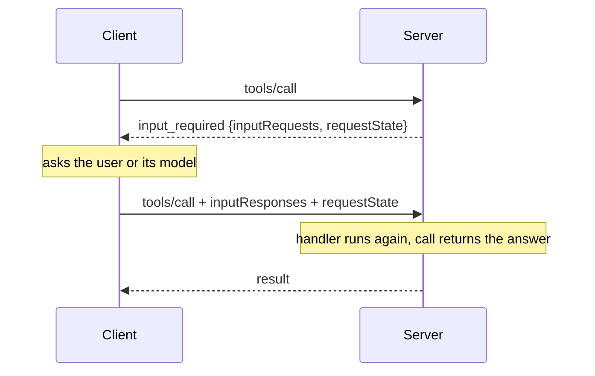

### Form elicitation

Ask the user a question or confirmation. `T` is a flat struct; tags (`enum`, `min`, `max`, `default`) shape the form. The action is `mcp.Accept`, `mcp.Decline` or `mcp.Cancel`.

```go
type Confirm struct {
	Confirm bool `json:"confirm" desc:"Really delete?" default:"false"`
}

ans, action, err := mcp.Elicit[Confirm](ctx, "Delete "+in.ID+"?")
if err != nil { return mcp.Empty{}, err }
if action != mcp.Accept || !ans.Confirm { return mcp.Empty{}, mcp.ToolError("not confirmed") }
```

### URL elicitation

Send the user to your own web page (sign-in, payment). The page's backend calls `mcp.CompleteElicitation(id)` when done; the waiting handler continues. Approving before the client retries is fine.

```go
id, err := ctx.ElicitURL("Sign in", "https://example.com/connect?e={id}") // {id} is filled in
if err != nil { return out, err }
<-ctx.ElicitDone(id)                       // closed by mcp.CompleteElicitation(id) on your page
```

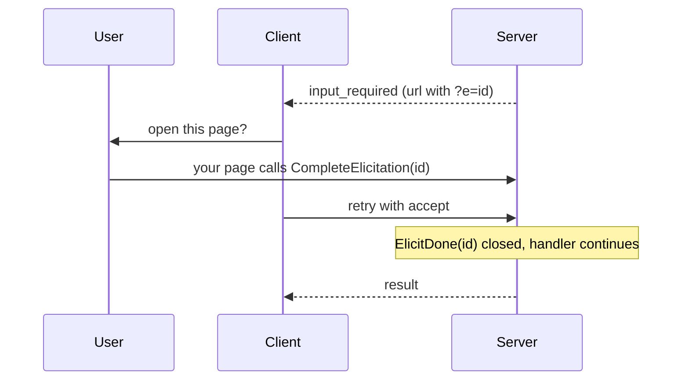

### Sampling

Ask the client's own model for a completion, so your server needs no model access. The client must declare sampling; use `@MCP.Requires(sampling)`.

```go
res, err := ctx.Sample(mcp.SampleReq{
	System:    "Summarize in one sentence.",
	Messages:  []mcp.SampleMsg{mcp.SampleText(mcp.RoleUser, text)},
	MaxTokens: 120,
})
if err != nil { return out, err }
return Out{Summary: res.Text}, nil
```

### Roots

Read the client's project roots, for example to know which folders to work on.

```go
roots, err := ctx.Roots()                  // @MCP.Requires(roots)
if err != nil { return out, err }
for _, r := range roots { use(r.URI) }
```

### Progress and logs

Report progress when the client sent a progress token. Logs are sent only when the request asks for a log level.

```go
for i, item := range items {
	ctx.Progress(float64(i+1), float64(len(items)), "importing "+item)
}
ctx.Log().Info("import done", "count", len(items))
```

### Long-running tasks

Extension `io.modelcontextprotocol/tasks`. With `@MCP.Task` the server decides: a client that supports tasks gets a handle at once and polls; others get the result directly. Watch `ctx.Done()` for cancellation.

```go
// @MCP.Tool("import_notes")
// @MCP.Task(optional, ttl="10m", poll="2s")     // optional | required
func Import(ctx mcp.Context, _ mcp.Empty) (int, error) {
	if ctx.Err() != nil { return 0, ctx.Err() }   // tasks/cancel
	...
}
```

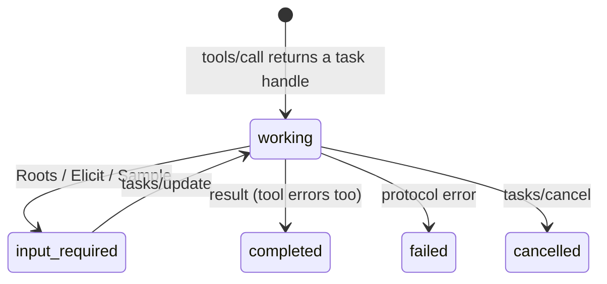

## Resources

### Static and templated resources

Data the application reads, such as files or records. A fixed URI or an RFC 6570 template; `{id}` binds to a `uri:"id"` field. An exact URI wins over a template.

```go
// @MCP.Resource("note:///{id}", title="Note", mime="text/plain")
func Read(ctx mcp.Context, u NoteURI) (mcp.Contents, error) {   // NoteURI{ID string `uri:"id"`}
	n, ok := notes[u.ID]
	if !ok { return nil, mcp.ErrNotFound }                      // -32602 with data.uri
	return mcp.Contents{mcp.TextContent(n.Text)}, nil
}

// @MCP.Resource("note:///index", mime="application/json")
func Index(ctx mcp.Context) (mcp.Contents, error) { return mcp.JSONContents(ids()) }
```

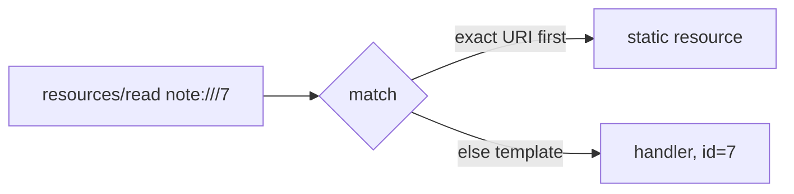

### Listing resources

Make concrete URIs discoverable through `resources/list`, paged with a cursor.

```go
// @MCP.ResourceList("note:///{id}")
func List(ctx mcp.Context, page mcp.PageReq) (mcp.Page[mcp.ResourceRef], error) {
	return mcp.Paginate(refs(), page), nil
}
```

### Change notifications

There is no push channel. A client opens `subscriptions/listen` with what it cares about; the stream is acknowledged first and stays open. Mark a resource `@MCP.Subscribable` and call `ctx.ResourceUpdated(uri)` when it changes.

```go
// @MCP.Resource("note:///{id}")
// @MCP.Subscribable
...
ctx.ResourceUpdated("note:///" + id)   // subscribers of that URI
ctx.ResourcesChanged()                 // list changed (also ToolsChanged, PromptsChanged)
```

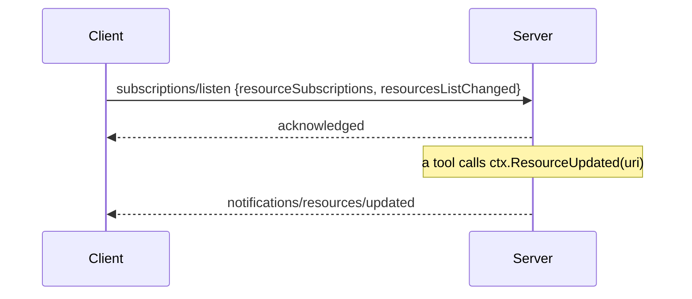

## Prompts and completion

### Prompts

Conversation starters the user picks, like a slash command with arguments. A prompt returns messages, optionally with resources embedded.

```go
// @MCP.Prompt("summarize_notes", title="Summarize note")
func SummarizeNotes(ctx mcp.Context, a Args) (mcp.Messages, error) {   // Args{ID string; Style string `json:",omitempty"`}
	return mcp.Messages{
		mcp.UserText("Summarize this note (" + a.Style + "):"),
		mcp.User(mcp.EmbedResource("note:///" + a.ID)),
	}, nil
}
```

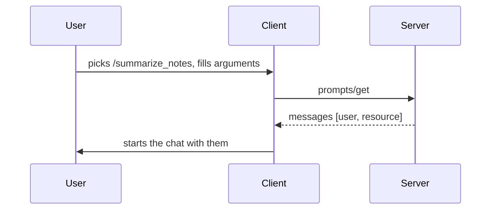

### Completion

Autocomplete for a prompt argument or a resource template variable. Fixed values on the prompt, or a function for computed ones (`for` is the prompt name or the URI template).

```go
// @MCP.Complete(arg="style", values="short,bullets")      // on the prompt

// @MCP.Complete(for="note:///{id}", arg="id")
// @MCP.Complete(for="summarize_notes", arg="id")
func CompleteID(ctx mcp.Context, partial string, resolved map[string]string) (mcp.Completion, error) {
	return mcp.Values(idsWithPrefix(partial)...), nil
}
```

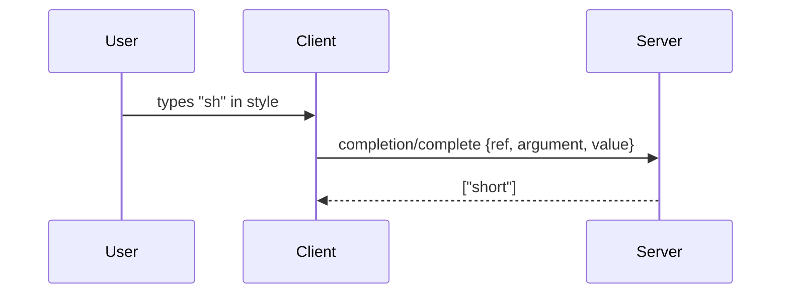

## Runtime

### Using pkg/mcp by hand

Annotations only generate calls to `pkg/mcp`, so you can use it directly, for example inside an existing HTTP server.

```go
srv := mcp.NewServer(mcp.Info{Name: "notes", Version: "1.0.0"}, mcp.WithPageSize(50))
_ = mcp.AddTool(srv, mcp.ToolDef{Name: "add_note"}, Add)   // also AddResource, AddPrompt, srv.Use, ...
mux := http.NewServeMux()
srv.Mount(mux, "/mcp")
log.Fatal(http.ListenAndServe(":8080", mux))
```

### Options

| Option | Effect |
|---|---|
| `WithInstructions(text)` | instructions of `server/discover` |
| `WithAllowedOrigins(...)` | accepted `Origin` values (default: localhost) |
| `WithKeepAlive(d)` | keep-alive of listen streams |
| `WithPageSize(n)` | page size of list operations |
| `WithBaseURL(url)` | base of relative icon sources |
| `WithCache(ttl, scope)` | `ttlMs` and `cacheScope` hints |
| `WithStateKey(key)` | secret for `requestState`; share it between instances (`GOMCP_STATE_KEY` in generated servers) |
| `WithAuth(schemes...)` | authentication schemes |

### Errors

Tool errors are results with `isError: true`. Protocol errors are JSON-RPC errors: `-32602` invalid params (also resource not found), `-32603` internal, `-32020` header mismatch, `-32021` missing client capability, `-32022` unsupported protocol version.

```go
return out, mcp.ToolError("note not found")        // the model sees it
return out, mcp.ErrInvalidParams("bad id")         // the client sees it
return nil, mcp.ErrNotFound                         // resources: -32602 + data.uri
```

### What is automatic and what is not

Automatic: discover, header and version checks, `resultType`, cache hints, listen streams, schemas and argument validation, origin check, OAuth metadata and challenges, scope checks, tasks, icon resolution.

Not supported, removed by 2026-07-28: sessions and `initialize`, `ping`, `logging/setLevel`, `resources/subscribe`, the GET stream and resumability, server-to-client requests, batching, legacy HTTP+SSE. Older revisions answer `-32022`. Client registration and issuing tokens belong to your authorization server.

## Contributing

Checks, tests and how to try a change with a real client: [README_DEV.md](README_DEV.md). Issues and pull requests are welcome; security problems go through [SECURITY.md](SECURITY.md).
