# GoMCP

[](https://github.com/StevenCyb/GoMCP/releases)
[](LICENSE)
[](go.mod)
[](https://github.com/StevenCyb/GoMCP/actions/workflows/test.yml)
[](https://pkg.go.dev/github.com/StevenCyb/GoMCP)
[](https://modelcontextprotocol.io/specification/2026-07-28)

Annotation-driven [MCP](https://modelcontextprotocol.io) server generator for
Go. Write plain handler functions, sprinkle `@MCP.*` comments on top, and
GoMCP generates a runnable `main` package serving a spec-compliant
Streamable HTTP MCP endpoint with tools, resources and prompts.

**Run it where you want: remote or local.** The same annotated code runs as an HTTP server that many clients
reach over the network, or as a local process that one client (Claude Desktop, an IDE, an agent) starts itself
over stdin and stdout. You pick when you start it, the code does not change.

**Supported spec: MCP [2026-07-28](https://modelcontextprotocol.io/specification/2026-07-28)** — the stateless
revision (no sessions, no `initialize`, every request carries its protocol version and client capabilities).
Older revisions are not supported.

> **Status: v0.x.** The exported API of `pkg/mcp` may still change between minor versions. Requires Go 1.26.2 or newer.
> Code snippets in this document are abbreviated; runnable code is in [`examples/`](examples).

## See It In 5 Seconds

Fastest start: `gomcp init hello && cd hello && gomcp serve .` (see [Install](#install)). Or write this in a Go module that requires GoMCP (`go get github.com/StevenCyb/GoMCP`):

```go
package api

import "github.com/StevenCyb/GoMCP/pkg/mcp"

type HelloIn struct {
	Name string `json:"name" desc:"Who to greet"`
}

// @MCP.Tool("hello", description="Greets someone")
func Hello(ctx mcp.Context, in HelloIn) (string, error) {
	return "Hello " + in.Name, nil
}
```

Run:

```sh
gomcp serve .
```

Get:

- A Streamable HTTP MCP endpoint at `/mcp` with `tools/list` and `tools/call`.
- An input schema derived from your Go types (and an output schema when the handler returns a struct).
- Auto-generated bootstrap (`main`, transport, auth, lifecycle wiring).

> More runnable servers are in [`examples/`](examples) (index with how to run each):
>
> - [`files`](examples/files): read-only directory browser for a local client over stdio.
> - [`todo`](examples/todo): todo list kept in a JSON file, with Setup and Teardown.
> - [`fetch`](examples/fetch): URL fetcher with an allowlist, size limit and timeout.
> - [`features`](examples/features): every feature once.

## Why GoMCP

You write the handler, GoMCP writes everything around it.

- **Handlers stay plain Go.** A function with a typed input and output plus an `@MCP.Tool` comment is the whole tool. Schemas, validation, registration and the server `main` are generated from your types.
- **Nothing lands in your module.** The generated code is built with Go's overlay mechanism: no generated files to commit or review, and no `go:generate` step.
- **Remote or local from one codebase.** The same code runs as an HTTP server for many clients (`gomcp serve`) or as a local process that one client starts (`gomcp stdio`).
- **The newest spec.** It implements MCP 2026-07-28 (stateless, `server/discover`, input requests, tasks) from day one.
- **Tested end to end.** The `examples/features` project runs through a test client over HTTP and stdio in CI on Linux and Windows, and a smoke test of every merged commit runs on Linux, Windows and macOS.

It has its own runtime (`pkg/mcp`), so you can also skip the annotations and register tools in code. If you prefer to write every registration yourself, or need a revision older than 2026-07-28, another MCP library for Go is the better fit.

## Install

```sh
go install github.com/StevenCyb/GoMCP/cmd/gomcp@latest
```

The binary is called `gomcp`. Then scaffold a first server in one step:

```sh
gomcp init hello && cd hello
gomcp serve .
```

## Contents

- [See It In 5 Seconds](#see-it-in-5-seconds)
- [Why GoMCP](#why-gomcp)
- [Install](#install)
- [Basics](#basics)
  - [Annotation syntax](#annotation-syntax)
- [CLI](#cli)
  - [init](#init)
  - [build, serve and watch](#build-serve-and-watch)
  - [Flags and environment](#flags-and-environment)
- [Transports](#transports)
  - [Local or remote](#local-or-remote)
- [Server](#server)
  - [Identity and instructions](#identity-and-instructions)
  - [Stateless requests](#stateless-requests)
  - [Transport settings](#transport-settings)
  - [Caching hints](#caching-hints)
  - [Middleware](#middleware)
  - [Setup and teardown](#setup-and-teardown)
  - [Static assets and icons](#static-assets-and-icons)
  - [Custom HTTP handlers](#custom-http-handlers)
- [Authentication](#authentication)
  - [Bearer and API keys](#bearer-and-api-keys)
  - [OAuth resource server](#oauth-resource-server)
  - [Scopes](#scopes)
- [Tools](#tools)
  - [Defining a tool](#defining-a-tool)
  - [Hints, metadata and requirements](#hints-metadata-and-requirements)
  - [Results and errors](#results-and-errors)
  - [Asking the user (forms)](#asking-the-user-forms)
  - [URL elicitation](#url-elicitation)
  - [Sampling](#sampling)
  - [Roots](#roots)
  - [Progress and logs](#progress-and-logs)
  - [Long-running tasks](#long-running-tasks)
- [Resources](#resources)
  - [Static and templated resources](#static-and-templated-resources)
  - [Listing resources](#listing-resources)
  - [Change notifications](#change-notifications)
- [Prompts and completion](#prompts-and-completion)
  - [Prompts](#prompts)
  - [Completion](#completion)
- [Runtime](#runtime)
  - [Using pkg/mcp by hand](#using-pkgmcp-by-hand)
  - [Options](#options)
  - [Errors](#errors)
  - [What is automatic and what is not](#what-is-automatic-and-what-is-not)
- [Contributing](#contributing)

## Basics

### Annotation syntax

Annotations are comment lines. Arguments are comma-separated: positional values (a name, or several for `AuthScopes`, `Hint` and `Requires`), `key="value"`, `key=1` or bare flags such as `readOnly`. The doc comment above is the description. Types in the signature become the JSON schemas.

```go
// Adds a short text note.
//
// @MCP.Tool("add_note", title="Add note")
// @MCP.AuthScopes("notes:write")
func Add(ctx mcp.Context, in AddIn) (Note, error) {
	note := Note{ID: newID(), Text: in.Text, Tag: in.Tag}
	notes[note.ID] = note
	return note, nil
}

type AddIn struct {
	Text string `json:"text" desc:"Note body" min:"1" max:"500"`        // required: no omitempty
	Tag  string `json:"tag,omitempty" enum:"work,idea" default:"idea"`  // optional
}
```

Struct tags: `desc enum min max default format`, plus `uri` (binds a resource URI variable, see [Resources](#static-and-templated-resources)) and `header`. A field is required unless it has `omitempty` or is a pointer; `json:"-"` hides it. A period at the end of an annotation line is ignored; any other text after the closing `)` is an error, so put comments on their own line.

The examples share these helpers (see [examples/features/model.go](examples/features/model.go)): `type Note struct{ ID, Text, Tag string }`, `type IDIn struct{ ID string }` (tag `json:"id"`) and `var notes map[string]Note`. `newID`, `ids`, `allNotes` and `upload` stand for your own code.

## CLI

### init

`init <dir>` creates a new project: `go.mod`, an annotated `api.go` with one `hello` tool, `.gitignore` and a `README.md`. It then runs `go get` for this gomcp's version and `go mod tidy`. It refuses a directory that already has files. If `go get` fails (offline), the files stay and the error says what to run.

```sh
gomcp init ./hello                          # module example.com/hello
gomcp init ./hello --module github.com/me/hello
gomcp init ./hello --no-get                 # only write the files
```

### build, serve and watch

`build` compiles a single binary, `serve` builds and runs it as an HTTP server, `watch` rebuilds and restarts when a `.go` file (not `_test.go`), `go.mod`, `go.sum` or `.env` changes, and keeps the old server if the rebuild fails. `stdio` builds and runs it for a local client, see [Local or remote](#local-or-remote).

```sh
gomcp build ./examples/features ./bin/notes   # one binary, contains both transports
gomcp serve ./examples/features               # build + run over HTTP, Ctrl-C stops gracefully
gomcp watch ./examples/features               # rebuild on change (HTTP only)
gomcp stdio ./examples/features               # build + run over stdin and stdout
gomcp call ./examples/features                # list the tools
gomcp call ./examples/features add_note '{"text":"hi"}'   # call a tool, print the result
gomcp version
```

`call` tries a project without an AI client: it builds the project, starts it over stdio, lists the tools or calls one and stops the server. Text results go to stdout, build logs and errors to stderr. Arguments are a JSON object (`-` reads it from stdin), `--json` prints the raw result, and the exit code is 1 when the tool returns an error or the server a protocol error. Tools that ask the client for input (forms, sampling) are reported, not answered; `--root <dir>` answers `roots/list`.

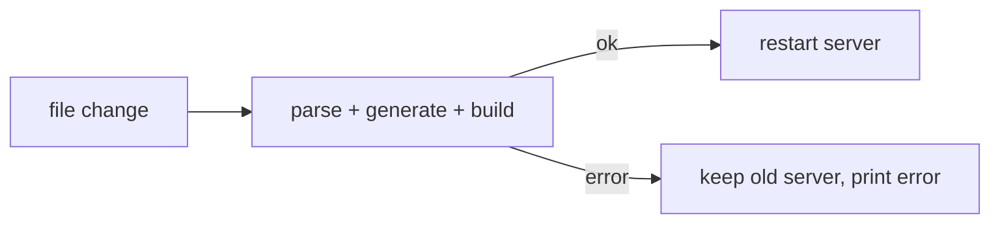

### Flags and environment

`--tags/-t` forwards build tags. `serve`, `watch`, `stdio` and `call` also take `--dotenv/-e` (default `<module>/.env`; real environment wins). `serve` and `watch` take `--addr/-a` (sets `GOMCP_ADDR`, default `127.0.0.1:8080`, loopback only; set it to expose the server and configure `@MCP.Auth` first).

```sh
gomcp serve ./examples/features --addr 127.0.0.1:8765 --dotenv ./dev.env
```

Deployment values for a built server, also read from `--dotenv`. They win over the annotations, which only give defaults:

| Variable | Overrides |
| --- | --- |
| `GOMCP_AUTH_RESOURCE` | `resource=` of `@MCP.Auth(type="oauth")`; the server does not start when neither is set |
| `GOMCP_AUTH_SERVERS` | `@MCP.AuthServer`, comma-separated |
| `GOMCP_BASE_URL` | `baseURL=` of `@MCP.Server` |

## Transports

### Local or remote

One annotated project, two ways to run it. HTTP is the default and serves many clients over the network. With stdio the client starts the server as a child process and talks to it over stdin and stdout, which is how desktop clients and IDEs run local tools.

```sh
gomcp serve ./proj                  # remote: HTTP on 127.0.0.1:8080 (or --addr)
gomcp stdio ./proj                  # local: stdin and stdout, for a client that starts it

gomcp build ./proj ./bin/notes      # one binary, both ways:
./bin/notes                         #   HTTP (default)
./bin/notes --stdio                 #   stdio (or GOMCP_TRANSPORT=stdio)
```

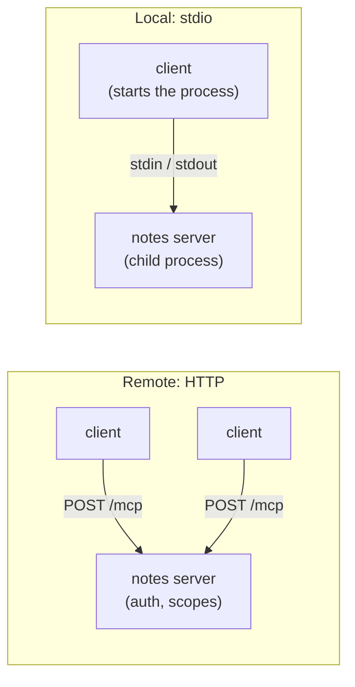

A client config for a local server. Build once and start the binary, because `gomcp stdio ./proj` compiles on every start:

```json
{ "command": "./bin/notes", "args": ["--stdio"] }
```

What changes with stdio:
- **No authentication.** The caller is the process that started the server, so `@MCP.Auth` is ignored and `@MCP.AuthScopes` are not checked. Anyone who can start the binary can use every feature.
- **One client per process.** There are no HTTP headers, origins or listen address (`--addr` does not apply).
- **Only protocol messages on stdout.** Log to stderr (the `log` package does). A `fmt.Println` in your code or setup breaks the connection.
- **No stdio mode for `gomcp watch`.** A restart would end the client's connection. Use `gomcp stdio` or the built binary with `--stdio`.
- **Relative icons are left out** unless a base URL is configured (`@MCP.Server(baseURL=...)`), because stdio has no server URL to resolve them against. Use absolute or `data:` URLs.
- **Same behaviour otherwise.** Tools, resources, prompts, elicitation, sampling, roots, tasks and `subscriptions/listen` work the same. A listen request stays open until the client cancels it with `notifications/cancelled`, and a cancelled request gets no response.

## Server

### Identity and instructions

Name, version and instructions of the server. Clients show the name and may add the instructions to the model's system prompt. Package-level, any comment block in the package.

```go
// @MCP.Server("notes", title="Notes", version="1.0.0", website="https://example.com")
// @MCP.Icon("assets/notes.svg")
// @MCP.Instructions("Use the notes tools to create and read short notes.")
package api
```

### Stateless requests

No sessions and no `initialize`. Every request carries the protocol version and the client's capabilities (in its `_meta` field, the metadata every MCP request has), so any instance can answer it. Instances behind one endpoint must share `GOMCP_STATE_KEY`, which signs the `requestState` of [input requests](#asking-the-user-forms). Headers `Mcp-Protocol-Version`, `Mcp-Method` and `Mcp-Name` mirror the body for gateways. Mismatch is `-32020`, unknown version `-32022`.

```go
// nothing to write: gomcp validates headers and _meta, and answers server/discover
```

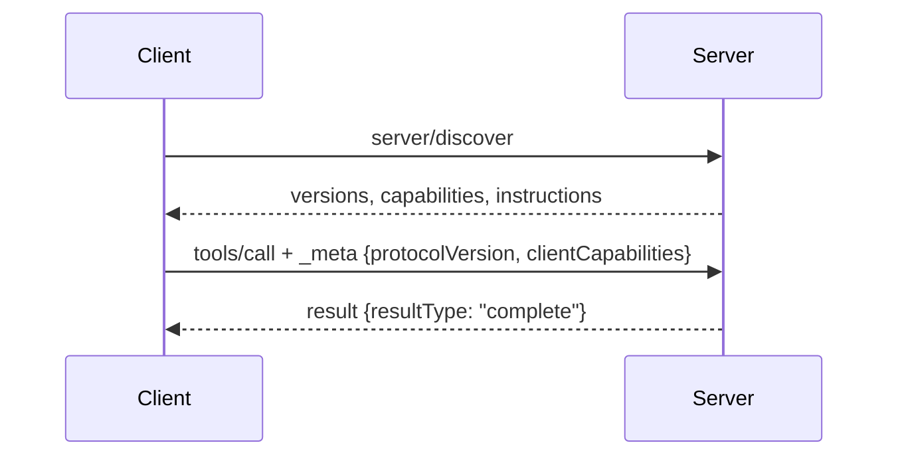

### Transport settings

These settings apply to HTTP; over stdio there is no endpoint, origin or keep-alive ([Local or remote](#local-or-remote)). One endpoint, POST only (GET and DELETE answer `405`). Origins are checked (`403`): without `@MCP.AllowedOrigin` only localhost origins pass, and a request without an `Origin` header is not checked. Lists are paged only if you set `@MCP.PageSize` (default: everything at once). Listen streams get keep-alive comments (default `20s`).

```go
// @MCP.Endpoint("/mcp")
// @MCP.AllowedOrigin("https://claude.ai")
// @MCP.KeepAlive("30s")
// @MCP.PageSize(50)
package api
```

### Caching hints

Tells clients how long discover, list and read results may be reused (`ttlMs`) and by whom (`cacheScope`: `private` by default, `public` only if you say `scope="public"`).

```go
// @MCP.Cache("5m", scope="private")
package api
```

### Middleware

Wraps tool calls, prompt gets, resource reads and completions (not lists or `server/discover`) for logging, metrics or rate limits. Attach with `@MCP.Use(fn)` at package level (everything) or on one feature. `@MCP.Middleware` on the function is optional: it only makes the parser check the signature.

```go
// @MCP.Middleware
func Logging(ctx mcp.Context, req mcp.Request, next mcp.Handler) (any, error) {
	log.Printf("%s %s", req.Kind, req.Name)
	return next(ctx, req)
}

// on one tool:
// @MCP.Tool("add_note", description="Adds a note")
// @MCP.Use(api.Logging)
func Add(ctx mcp.Context, in AddIn) (Note, error) {
	note := Note{ID: newID(), Text: in.Text}
	notes[note.ID] = note
	return note, nil
}
```

Or for every call, in a package comment:

```go
// @MCP.Use(api.Logging)
package api
```

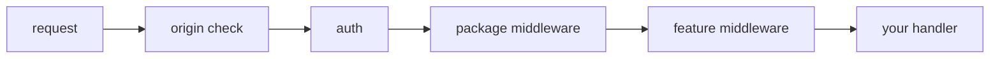

### Setup and teardown

Run code once when the server starts and stops, for example to open and close a database. `Setup` may return an error that stops the start.

```go
// @MCP.Setup
func Setup() error { db = open(); return nil }

// @MCP.Teardown
func Teardown() { db.Close() }
```

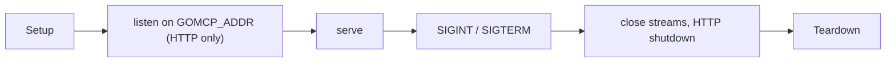

### Static assets and icons

Serve embedded files (icons, images) from the same server, without authentication. The prefix must equal the embedded directory name (`//go:embed assets` goes with `/assets`). A relative icon path such as `assets/add.svg` on any feature becomes `<base URL or request host>/assets/add.svg`.

```go
// @MCP.ServeAssets("/assets")
//go:embed assets
var Assets embed.FS

// @MCP.Tool("add_note", description="Adds a note")
// @MCP.Icon("assets/add.svg")
func Add(ctx mcp.Context, in AddIn) (Note, error) {
	note := Note{ID: newID(), Text: in.Text}
	notes[note.ID] = note
	return note, nil
}
```

### Custom HTTP handlers

Serve a plain HTTP handler next to the MCP endpoint, for example the sign-in page or the callback of a [URL elicitation](#url-elicitation). `@MCP.HTTPHandler` takes a [`http.ServeMux` pattern](https://pkg.go.dev/net/http#ServeMux) and goes on a `func(http.ResponseWriter, *http.Request)`.

```go
// @MCP.HTTPHandler("GET /health")
func Health(w http.ResponseWriter, r *http.Request) {
	_, _ = fmt.Fprintln(w, "ok")
}

// @MCP.HTTPHandler("POST /sign-in/{id}")
func SignIn(w http.ResponseWriter, r *http.Request) {
	id := r.PathValue("id") // the {id} of the pattern
	_, _ = fmt.Fprintln(w, "sign-in", id)
}
```

Wildcards such as `{id}` work as in `http.ServeMux`; read them with `r.PathValue`.

- **HTTP only:** over stdio there is no listener, so the handler is never served.
- **No protection from gomcp:** the origin check and `@MCP.Auth` apply to the MCP endpoint only. The handler must authenticate its callers itself.
- **No clashes:** a pattern that is invalid or clashes with the MCP endpoint, an assets route or another handler is an error when gomcp builds the project.

## Authentication

### Bearer and API keys

For internal tokens and API keys: your verifier checks the token and returns the caller. Failure is a plain `401` (`Bearer error="invalid_token"`, the verifier's error text is not sent). Several `@MCP.Auth` are allowed, the first success wins.

```go
// @MCP.Auth(type="bearer")
func VerifyAPIKey(ctx context.Context, token string) (mcp.Principal, error) {
	if token != os.Getenv("API_KEY") { return mcp.Principal{}, errors.New("invalid") }
	return mcp.Principal{Subject: "service", Scopes: []string{"notes:read"}}, nil
}
```

### OAuth resource server

gomcp verifies tokens, it never issues them. Authentication belongs to HTTP: over stdio it is ignored ([Local or remote](#local-or-remote)). It serves the protected resource metadata, challenges unauthenticated calls and checks scopes. Needs the resource URL: `resource=` or `GOMCP_AUTH_RESOURCE` (see [Flags and environment](#flags-and-environment)). `@MCP.AuthServer` and `@MCP.AuthScope` declare the issuer and scopes for the metadata and the challenge (default scopes go into the `401` challenge).

```go
// @MCP.Auth(type="oauth", resource="https://notes.example.com/mcp")
// @MCP.AuthServer("https://auth.example.com")
// @MCP.AuthScope("notes:read", default)
func VerifyToken(ctx context.Context, token string) (mcp.Principal, error) {
	claims, err := parseJWT(token) // your JWT library: check signature, issuer, audience and expiry
	if err != nil { return mcp.Principal{}, err }
	return mcp.Principal{Subject: claims.Subject, Scopes: claims.Scopes}, nil
}
```

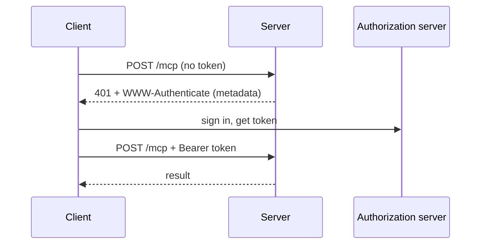

### Scopes

Limit a feature to callers with certain scopes. Scopes on one `@MCP.AuthScopes` line are alternatives (any one is enough); repeated lines are all required. A missing scope gives `403 insufficient_scope`, so the client can ask the user for more permission. Needs an `@MCP.Auth`: without one the scopes are not checked. They are checked on call, get and read, not on list. In handlers, `ctx.Principal()` is the caller.

```go
// @MCP.Tool("delete_note")
// @MCP.AuthScopes("notes:write")
func Delete(ctx mcp.Context, in IDIn) (mcp.Empty, error) {
	log.Printf("%s deletes %s", ctx.Principal().Subject, in.ID) // the caller
	delete(notes, in.ID)
	return mcp.Empty{}, nil
}
```

```go
// @MCP.AuthScopes("notes:write", "notes:admin") // write OR admin
// @MCP.AuthScopes("notes:read")                 // AND read
```

The `403` challenge names the first scope of every group the caller misses.

## Tools

### Defining a tool

A tool lets the model do something. Input schema comes from the input struct; a struct result also gives an output schema. Invalid arguments become tool errors the model can fix itself.

The signature is always `func(ctx mcp.Context, in In) (Out, error)`.

```go
type IDIn struct {
	ID string `json:"id" desc:"Note id"`
}

// @MCP.Tool("get_note", description="Returns a note by id")
func Get(ctx mcp.Context, in IDIn) (Note, error) {
	note, ok := notes[in.ID]
	if !ok { return Note{}, mcp.ToolError("note not found") }
	return note, nil
}
```

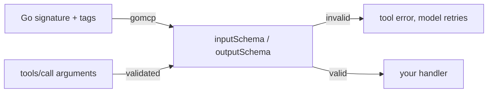

### Feature flags

`@MCP.FeatureFlag("name")` on a tool, resource or prompt makes it switchable. Everything is enabled by default. Switch flags off when the server starts, with `GOMCP_DISABLED_FEATURES=beta,other` or `--disabled-features=beta,other` (built binary; both are merged). A disabled feature is not registered at all: it is not listed and cannot be called. The completion and listing of a disabled prompt or template are skipped too.

```go
// @MCP.Tool("delete_note")
// @MCP.FeatureFlag("destructive")
func Delete(ctx mcp.Context, in IDIn) (mcp.Empty, error) { /* ... */ }
```

```sh
GOMCP_DISABLED_FEATURES=destructive gomcp serve ./examples/features
./bin/notes --disabled-features=destructive
```

### Hints, metadata and requirements

Hints tell clients what a tool does (`readOnly`, `destructive`, `idempotent`, `openWorld`). `@MCP.Requires` names client capabilities the tool needs (`sampling`, `roots`, `elicitation`, `elicitation="url"`). It is not shown in `tools/list`; it is checked only when the tool is called. If the client did not declare them, the call fails with `-32021` (HTTP 400) before the handler runs.

```go
// @MCP.Tool("delete_note", description="Deletes a note")
// @MCP.Hint(destructive)
// @MCP.Requires(elicitation)
// @MCP.Meta(team="docs")
func Delete(ctx mcp.Context, in IDIn) (mcp.Empty, error) {
	ans, action, err := mcp.Elicit[Confirm](ctx, "Delete "+in.ID+"?") // Confirm: see Asking the user
	if err != nil { return mcp.Empty{}, err }
	if action != mcp.Accept || !ans.Confirm { return mcp.Empty{}, mcp.ToolError("not confirmed") }
	delete(notes, in.ID)
	return mcp.Empty{}, nil
}
```

### Results and errors

Return a struct (structured + text), a string, or `mcp.Result[T]` to send your own content blocks, such as links. If `Content` is set it replaces the automatic JSON text block; the structured value is still sent as `structuredContent`. `mcp.ToolError` is shown to the model; protocol errors go to the client.

> Any other error a tool returns, not only `mcp.ToolError`, is sent to the model as text. Only an `mcp.Error` (for example `mcp.ErrInvalidParams`) becomes a protocol error. Never put secrets, DSNs or file paths in error messages.

```go
func Get(ctx mcp.Context, in IDIn) (mcp.Result[Note], error) {
	n, ok := notes[in.ID]
	if !ok { return mcp.Result[Note]{}, mcp.ToolError("note not found") } // model sees it
	return mcp.Result[Note]{Structured: n, Content: []mcp.Content{mcp.ResourceLink("note:///" + n.ID)}}, nil
}
```

### Asking the user (forms)

One call, `mcp.Elicit[T]`, asks the user a question while your tool runs. `T` is a struct and becomes the form the client shows. A yes/no confirmation is a form with one `bool` field, a larger questionnaire is a form with more fields. There is nothing else to learn: the two examples below differ only in the struct. Needs `@MCP.Requires(elicitation)`.

`Elicit` returns the filled struct and the user's action: `mcp.Accept`, `mcp.Decline` or `mcp.Cancel`. On decline and cancel the struct is the zero value and the error is nil, so use the struct only on `Accept`.

**How the call works.** The server cannot call the client in the middle of a request, so outside a task:

- On the first run `Elicit` returns `mcp.ErrInputRequired`. Return it (or an error wrapping it) at once and do not continue with zero values.
- gomcp sends `input_required`, the client shows the form and retries, and your handler runs again from the top. This time `Elicit` returns the answer.
- Everything before the ask runs again on every retry (twice for one ask, three times for two). So ask first, act after, and keep the order of asks the same on every run.
- Inside a long-running task (`@MCP.Task`, client supports tasks) nothing is rerun: the call blocks until the client answers with `tasks/update`.

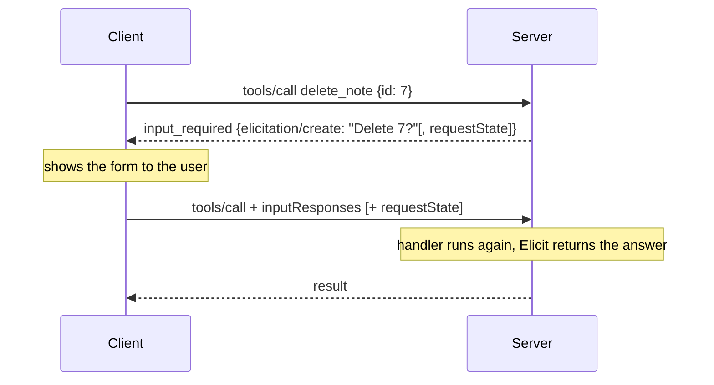

**Example 1: confirmation.** One `bool` field.

```go
type Confirm struct {
	Confirm bool `json:"confirm" desc:"Really delete?" default:"false"`
}

// @MCP.Tool("delete_note", description="Deletes a note")
// @MCP.Requires(elicitation)
func Delete(ctx mcp.Context, in IDIn) (mcp.Empty, error) {
	// 1st run: no answer yet -> ErrInputRequired, gomcp asks the client.
	// 2nd run (after the retry): same line, now returns the user's answer.
	ans, action, err := mcp.Elicit[Confirm](ctx, "Delete "+in.ID+"?")
	if err != nil { return mcp.Empty{}, err } // returns ErrInputRequired on the 1st run
	if action != mcp.Accept || !ans.Confirm { return mcp.Empty{}, mcp.ToolError("not confirmed") }
	// ... only here, with the answer, do the real work
	return mcp.Empty{}, nil
}
```

**Example 2: several fields.** Same call, bigger struct.

```go
type NoteDetails struct {
	Tag      string `json:"tag"               desc:"Category" enum:"work,private,idea"`
	Priority int    `json:"priority"          desc:"Priority" min:"1" max:"5" default:"3"`
	Comment  string `json:"comment,omitempty" desc:"Optional comment"`
}

// @MCP.Tool("detail_note", description="Asks the user for extra details and stores them on the note")
// @MCP.Requires(elicitation)
func Detail(ctx mcp.Context, in IDIn) (Note, error) {
	note := notes[in.ID]
	d, action, err := mcp.Elicit[NoteDetails](ctx, "Add details for "+in.ID)
	if err != nil { return Note{}, err }
	if action != mcp.Accept { return note, nil } // declined or cancelled: keep as is
	note.Tag, note.Priority, note.Comment = d.Tag, d.Priority, d.Comment
	notes[note.ID] = note
	return note, nil
}
```

**What `T` may contain.** Fields may be string, bool, int, float or `time.Time`; a `[]string` with an `enum` tag is a multi-select. A field is optional with `omitempty` or as a pointer. Tags: `desc`, `format`, `enum`, `min`, `max`, `default`. They are sent to the client as the form schema; gomcp does not check the answer against them again. Nested structs, maps and other lists make `Elicit` return an error (`elicitation form: ...`) at runtime, not at generation. `@MCP.Elicitation` on the struct is an optional marker: the parser only checks that it sits on a struct.

**Capability.** `@MCP.Requires(elicitation)` checks the client's capability before the handler runs and answers `-32021` otherwise. Without it, `Elicit` itself fails with an error wrapping `mcp.ErrCapability` (test with `errors.Is`), which the model sees as a tool error.

Full version: [examples/features/elicitation.go](examples/features/elicitation.go). URL elicitation, sampling and roots below use the same retry flow, only the question differs.

### URL elicitation

Send the user to your own web page (sign-in, payment) and wait until it reports back. Needs `@MCP.Requires(elicitation="url")`. A decline or cancel makes `ElicitURL` return an error wrapping `mcp.ErrDeclined`.

The page cannot call gomcp. Your web backend tells an endpoint in the MCP server's process, and that endpoint calls `mcp.CompleteElicitation(id)`. You add that endpoint with [`@MCP.HTTPHandler`](#custom-http-handlers). The sign-in page itself may be served by the same server or by any other service.

> gomcp does not check who completes: the client knows the `id` too (it is in the URL), and an `@MCP.HTTPHandler` is not behind the authentication of the MCP endpoint. Accept calls only from your own backend, and only after the user signed in on your page.

```go
// @MCP.Tool("connect_account", description="Links an account via a sign-in page")
// @MCP.Requires(elicitation="url")
func Connect(ctx mcp.Context, _ mcp.Empty) (mcp.Empty, error) {
	id, err := ctx.ElicitURL("Sign in", "https://login.example.local/connect?e={id}") // {id} is filled in
	if err != nil { return mcp.Empty{}, err } // 1st run: ErrInputRequired, gomcp asks the client
	select {
	case <-ctx.ElicitDone(id): // closed when your endpoint calls mcp.CompleteElicitation(id)
		return mcp.Empty{}, nil
	case <-ctx.Done():         // never closes for an unknown, expired or foreign id: always keep a way out
		return mcp.Empty{}, ctx.Err()
	case <-time.After(10 * time.Minute):
		return mcp.Empty{}, mcp.ToolError("sign-in timed out")
	}
}
```

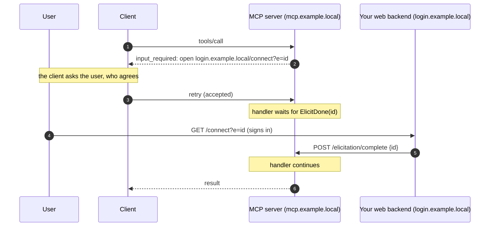

Steps 4 and 5 may happen before step 3: the user can finish before the client retries. The server remembers the `id` for 30 minutes.

Steps 4 and 5, on `login.example.local` (your web backend, here in Go; any language works):

```go
http.HandleFunc("GET /connect", func(w http.ResponseWriter, r *http.Request) {
	id := r.URL.Query().Get("e") // the {id} from the URL the MCP server sent
	// ... sign the user in here ...
	body, _ := json.Marshal(map[string]string{"id": id})
	resp, err := http.Post("https://mcp.example.local/elicitation/complete", "application/json", bytes.NewReader(body))
	if err != nil { http.Error(w, "could not report back", http.StatusBadGateway); return }
	defer resp.Body.Close()
	if resp.StatusCode != http.StatusNoContent { http.Error(w, "could not report back", http.StatusBadGateway); return }
	fmt.Fprint(w, "Done, you can close this page.")
})
```

Step 5 arrives at `mcp.example.local`, in the MCP server's process. This handler is the only place that calls gomcp:

```go
// @MCP.HTTPHandler("POST /elicitation/complete")
func CompleteSignIn(w http.ResponseWriter, r *http.Request) {
	var in struct{ ID string `json:"id"` }
	if json.NewDecoder(r.Body).Decode(&in) != nil || !mcp.CompleteElicitation(in.ID) {
		http.Error(w, "unknown id", http.StatusNotFound) // unknown or expired
		return
	}
	w.WriteHeader(http.StatusNoContent) // the waiting handler continues now
}
```

Protect `POST /elicitation/complete` with your own authentication (see the warning above). If the sign-in page is served by the same server, its handler can call `mcp.CompleteElicitation(id)` directly: see `SignInPage` and `CompleteSignIn` in [examples/features/elicitation.go](examples/features/elicitation.go).

### Sampling

Your server has no AI model. With sampling it borrows the model of the client: `ctx.Sample` sends a prompt to the client, the client's model answers, and you get the text back. The client chooses the model and may ask the user first. Needs `@MCP.Requires(sampling)`.

Example: a tool that lets the model pick a tag for a note. The answer is untrusted text, so check it before you use it.

```go
// @MCP.Tool("suggest_tag", description="Lets the model of the client pick a tag for a note")
// @MCP.Requires(sampling)
func SuggestTag(ctx mcp.Context, in IDIn) (Note, error) {
	note, ok := notes[in.ID]
	if !ok { return Note{}, mcp.ToolError("note not found") }

	res, err := ctx.Sample(mcp.SampleReq{
		System:    "Reply with exactly one word: work, private or idea.",
		Messages:  []mcp.SampleMsg{mcp.SampleText(mcp.RoleUser, note.Text)},
		MaxTokens: 10,
	})
	if err != nil { return Note{}, err } // returns ErrInputRequired on the first run

	tag := strings.ToLower(strings.TrimSpace(res.Text))
	if !slices.Contains([]string{"work", "private", "idea"}, tag) {
		return Note{}, mcp.ToolError("the model did not return a valid tag")
	}
	note.Tag = tag
	notes[note.ID] = note
	return note, nil
}
```

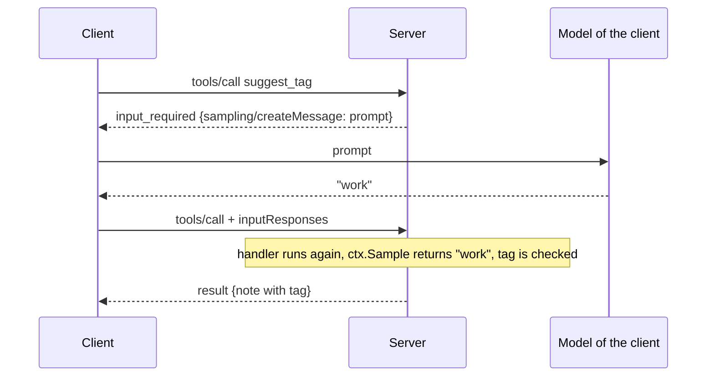

### Roots

The client tells the server which folders it works in, for example the project open in an IDE. `ctx.Roots` returns them as URIs, so a tool does not have to ask the user for a path. Needs `@MCP.Requires(roots)`.

Example: a tool that reports the folders of the client. The URIs (`file:///...`) point to the client's machine: a remote server cannot read them, a server started over stdio runs on the same machine and can.

```go
type RootsOut struct {
	Roots []string `json:"roots"`
}

// @MCP.Tool("list_roots", description="Lists the folders the client works in")
// @MCP.Hint(readOnly)
// @MCP.Requires(roots)
func ListRoots(ctx mcp.Context, _ mcp.Empty) (RootsOut, error) {
	roots, err := ctx.Roots()
	if err != nil { return RootsOut{}, err } // returns ErrInputRequired on the first run
	out := RootsOut{Roots: []string{}}
	for _, r := range roots { out.Roots = append(out.Roots, r.URI) }
	return out, nil
}
```

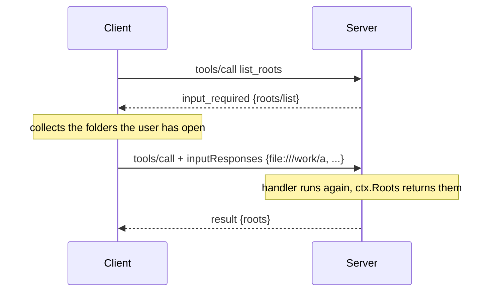

### Progress and logs

Two ways to tell the client what a running tool is doing. Both are sent on the response stream of the same call, and only if the client asks for them in the request:

- **Progress:** the client sends a progress token. `ctx.Progress(done, total, message)` then sends how far you are. Without a token the call does nothing. `total` 0 leaves the total out.
- **Logs:** the client sends a log level. `ctx.Log().Debug/Info/Warn/Error(msg, "key", value, ...)` sends a message to the client, but only if it is at or above that level (an unknown level is rejected). These are not your server's own log: use the `log` package for that, it goes to stderr.

Both are best effort: nothing is sent if the client cannot take a stream, and nothing is sent when the call runs as a task.

```go
type AddManyIn struct {
	Texts []string `json:"texts" desc:"Bodies of the notes to add"`
}

type AddManyOut struct {
	Added int `json:"added"`
}

// @MCP.Tool("add_many_notes", description="Adds several notes and reports progress")
func AddMany(ctx mcp.Context, in AddManyIn) (AddManyOut, error) {
	ctx.Log().Info("adding notes", "count", len(in.Texts))
	for i, text := range in.Texts {
		if ctx.Err() != nil { return AddManyOut{Added: i}, ctx.Err() } // the client cancelled
		// create note
		ctx.Log().Debug("note created", "index", i)                    // only if the level is debug
		ctx.Progress(float64(i+1), float64(len(in.Texts)), "added "+text)
	}
	ctx.Log().Info("done", "count", len(in.Texts))
	return AddManyOut{Added: len(in.Texts)}, nil
}
```

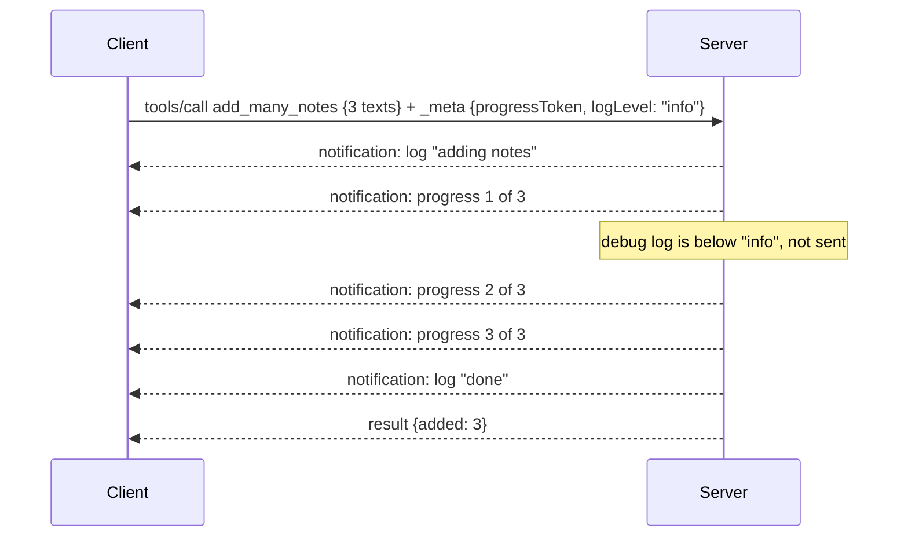

Without `progressToken` and `logLevel` in `_meta`, the client gets only the result.

### Long-running tasks

A normal tool call keeps the request open until the handler is done, which is a problem for a tool that takes minutes. With `@MCP.Task` the server runs the handler in the background and answers at once with a task handle. The client then asks `tasks/get` from time to time until the task is `completed`, and the result is in that answer. Your handler code is the same as for a normal tool.

```go
type ExportOut struct {
	Exported int `json:"exported"`
}

// @MCP.Tool("export_notes", description="Exports all notes, takes a while")
// @MCP.Task(optional, ttl="10m", poll="2s")
func Export(ctx mcp.Context, _ mcp.Empty) (ExportOut, error) {
	exported := 0
	for _, n := range allNotes() {
		if ctx.Err() != nil { return ExportOut{}, ctx.Err() } // the client sent tasks/cancel
		if err := upload(n); err != nil { return ExportOut{}, mcp.ToolError("upload failed") } // slow
		exported++
	}
	return ExportOut{Exported: exported}, nil // this is the result of the finished task
}
```

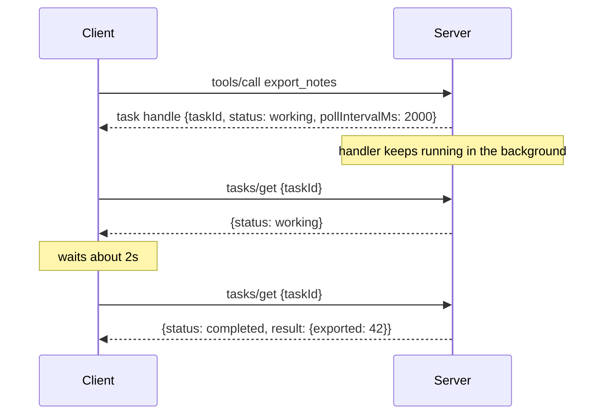

The settings of `@MCP.Task`:

- **Mode:** `optional`: a client that supports tasks (extension `io.modelcontextprotocol/tasks`) gets the handle at once, any other client waits and gets the result directly. `required`: clients without the extension are rejected with `-32021`. `forbidden` is the default without `@MCP.Task`.
- **`poll`:** how often the client should ask `tasks/get`.
- **`ttl`:** how long the task and its result are kept after it ended. After that `tasks/get` fails.

While a task runs:

- **Cancel:** the client can send `tasks/cancel`. The context of the handler is cancelled, so check `ctx.Err()` in long loops.
- **Asking the client:** if the handler asks for input (roots, a form, sampling), the task changes to `input_required` and the client answers with `tasks/update`. The handler is not rerun, see [Asking the user](#asking-the-user-forms).
- **No progress or logs:** `ctx.Progress` and `ctx.Log()` send nothing, the client sees only the task state.
- **Errors:** a `mcp.ToolError` still ends as `completed` (the result says it is an error). Only a protocol error makes the task `failed`.

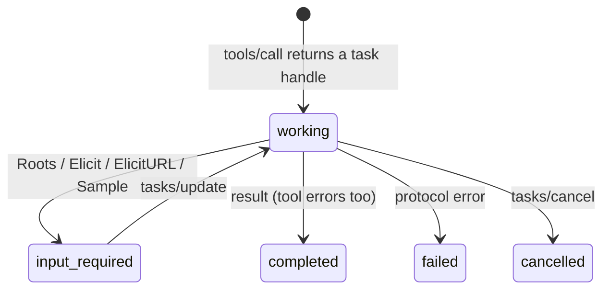

## Resources

### Static and templated resources

Data the application reads, such as files or records. A fixed URI or a template with simple `{name}` variables (letters, digits, `_`; each matches one segment, no `/`, `?` or `#`; RFC 6570 operators such as `{+path}` or `{?q}` are not supported and fail at server start). `{id}` binds to a `uri:"id"` field. An exact URI wins over a template.

```go
type NoteURI struct {
	ID string `uri:"id"` // filled from {id} of the URI
}

// @MCP.Resource("note:///{id}", title="Note", mime="text/plain")
func Read(ctx mcp.Context, u NoteURI) (mcp.Contents, error) {
	n, ok := notes[u.ID]
	if !ok { return nil, mcp.ErrNotFound }                      // -32602 with data.uri
	return mcp.Contents{mcp.TextContent(n.Text)}, nil
}

// @MCP.Resource("note:///index", mime="application/json")
func Index(ctx mcp.Context) (mcp.Contents, error) { return mcp.JSONContents(ids()) }
```

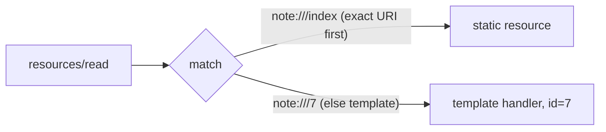

### Listing resources

Make concrete URIs discoverable through `resources/list`. The template must be declared with `@MCP.Resource` (as above). The function returns all concrete refs; the server merges them with the static resources and pages the result with `@MCP.PageSize`. The `PageReq` you get is always empty and a returned `Next` is ignored. Refs carry uri, name, title, description and mime type (the template's `mime=` is the fallback).

```go
// @MCP.ResourceList("note:///{id}")
func List(ctx mcp.Context, _ mcp.PageReq) (mcp.Page[mcp.ResourceRef], error) {
	var refs []mcp.ResourceRef
	for id := range notes {
		refs = append(refs, mcp.ResourceRef{URI: "note:///" + id, Name: id})
	}
	return mcp.Page[mcp.ResourceRef]{Items: refs}, nil // all of them, the server pages
}
```

### Change notifications

A normal call has no way to push something later. A client that wants to hear about changes opens `subscriptions/listen` and keeps it open; the server sends the notifications on that stream. You send them from any handler:

- `ctx.ResourceUpdated(uri)`: the content of a resource changed. The resource needs `@MCP.Subscribable`, and only clients subscribed to that exact URI get it.
- `ctx.ResourcesChanged()`, `ctx.ToolsChanged()`, `ctx.PromptsChanged()`: the list changed, for clients that asked for list changes.

```go
// @MCP.Resource("note:///{id}", title="Note", mime="text/plain")
// @MCP.Subscribable
func Read(ctx mcp.Context, u NoteURI) (mcp.Contents, error) {
	text := "..." // find the note text by u.ID
	return mcp.Contents{mcp.TextContent(text)}, nil
}

// @MCP.Tool("edit_note", description="Edits a note")
func Edit(ctx mcp.Context, in IDIn) (mcp.Empty, error) {
	// edit the note
	ctx.ResourceUpdated("note:///" + in.ID) // content changed: tells whoever subscribed to this URI
	return mcp.Empty{}, nil
}

// @MCP.Tool("add_note", description="Adds a note")
func Add(ctx mcp.Context, in AddIn) (mcp.Empty, error) {
	// create the note
	ctx.ResourcesChanged() // a new URI exists: tells whoever listens for list changes
	return mcp.Empty{}, nil
}
```

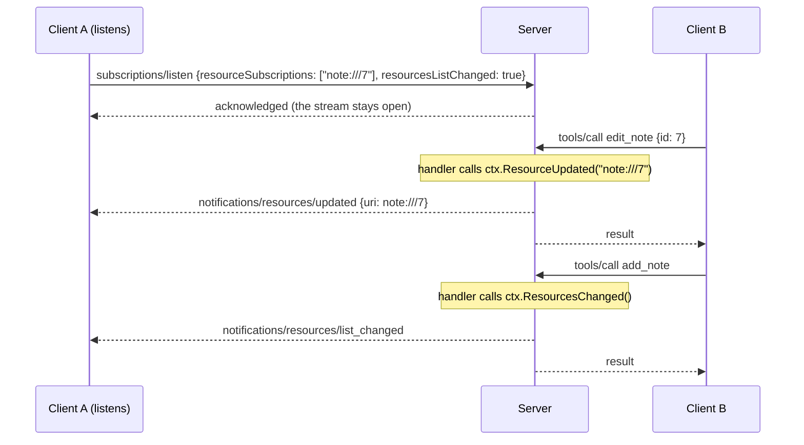

> `ctx.ResourceUpdated(uri)` reaches every listener subscribed to that exact URI (subject to the scopes of the resource). Per-user data needs per-user URIs that the resource handler authorizes via `ctx.Principal()`.

## Prompts and completion

### Prompts

Conversation starters the user picks, like a slash command with arguments. A prompt returns messages, optionally with resources embedded.

```go
type Args struct {
	ID    string `json:"id"`
	Style string `json:"style,omitempty"`
}

// @MCP.Prompt("summarize_notes", title="Summarize note")
func SummarizeNotes(ctx mcp.Context, a Args) (mcp.Messages, error) {
	return mcp.Messages{
		mcp.UserText("Summarize this note (" + a.Style + "):"),
		mcp.User(mcp.EmbedResource("note:///" + a.ID)),
	}, nil
}
```

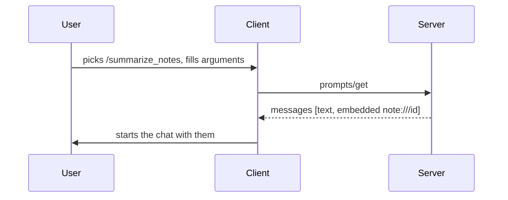

### Completion

Autocomplete for a prompt argument or a resource template variable, while the user types. Two ways: a fixed list on the prompt (first example, `style`), or a function for computed values (second example, `id`; its `for=` is the prompt name or the URI template). Prompt argument names come from the `json` tag (else the field name), and `arg=` must match them exactly. At most 100 values are returned; more set `hasMore`.

Fixed values go on the prompt as one more annotation. The prompt function itself is unchanged and still returns its messages; the completion is only the `@MCP.Complete` line, which lists the values for the argument `style`:

```go
// @MCP.Prompt("summarize_notes", title="Summarize note")
// @MCP.Complete(arg="style", values="short,bullets")
func SummarizeNotes(ctx mcp.Context, a Args) (mcp.Messages, error) {
	// build the messages, see Prompts
	return mcp.Messages{}, nil
}
```

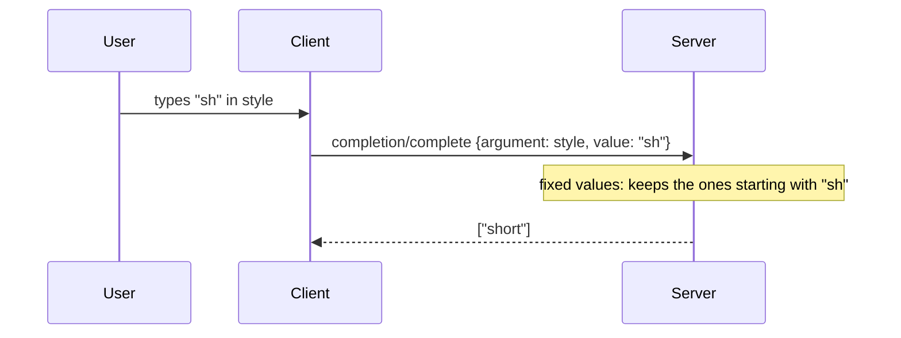

Computed values come from a separate function that returns the values (`mcp.Completion`), not messages. This one completes the `id` of the prompt and the `{id}` of the resource template:

```go
// @MCP.Complete(for="note:///{id}", arg="id")
// @MCP.Complete(for="summarize_notes", arg="id")
func CompleteID(ctx mcp.Context, partial string, resolved map[string]string) (mcp.Completion, error) {
	var ids []string
	for id := range notes {
		if strings.HasPrefix(id, partial) { ids = append(ids, id) }
	}
	slices.Sort(ids)
	return mcp.Completion{Values: ids}, nil
}
```

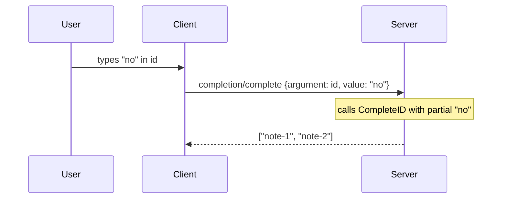

## Runtime

### Using pkg/mcp by hand

Annotations only generate calls to `pkg/mcp`, so you can use it directly, for example inside an existing HTTP server.

```go
srv := mcp.NewServer(mcp.Info{Name: "notes", Version: "1.0.0"}, mcp.WithPageSize(50))
_ = mcp.AddTool(srv, mcp.ToolDef{Name: "add_note"}, Add)   // also AddResource, AddPrompt, srv.Use, ...
mux := http.NewServeMux()
srv.Mount(mux, "/mcp")
log.Fatal(http.ListenAndServe(":8080", mux))
```

### Options

| Option | Effect |
|---|---|
| `WithInstructions(text)` | instructions of `server/discover` |
| `WithAllowedOrigins(...)` | accepted `Origin` values. Default: only localhost origins. Once set, only the listed ones pass (list localhost too). Requests without `Origin` always pass |
| `WithKeepAlive(d)` | keep-alive of listen streams (default 20s) |
| `WithPageSize(n)` | page size of tool, prompt, resource and template lists (default 0: everything at once) |
| `WithBaseURL(url)` | base of relative icon sources (default: scheme and host of the request; relative icons are left out where there is none, as over stdio) |
| `WithCache(ttl, scope)` | `ttlMs` and `cacheScope` hints on discover, list and read results (default: ttl 0, scope private) |
| `WithLimits(mcp.Limits{...})` | caps for tasks (`Tasks` 1000, `TasksPerCaller` 100, `TaskTTL` 1h, `TaskInputTimeout` 15m), listen streams (`Streams` 1000, `StreamsPerCaller` 20, `ListenEntries` 100 per request) and open URL elicitations (`Elicitations` 10000, `ElicitationsPerCaller` 100); zero keeps the default, over the cap the request is rejected (`-32600` for tasks and streams, `-32602` for `ListenEntries`) |
| `WithStateKey(key []byte)` | secret for `requestState`; without it a random key is made per process, so share it between instances (generated servers use `GOMCP_STATE_KEY`; empty means random) |
| `WithAuth(schemes...)` | authentication schemes |

### Errors

Tool errors are results with `isError: true`. Protocol errors are JSON-RPC errors: `-32600` invalid request (also exceeded limits and batching), `-32601` unknown method, `-32602` invalid params (also resource not found), `-32603` internal, `-32020` header mismatch, `-32021` missing client capability, `-32022` unsupported protocol version.

```go
return out, mcp.ToolError("note not found")        // the model sees it
return out, mcp.ErrInvalidParams("bad id")         // the client sees it
return nil, mcp.ErrNotFound                         // resources: -32602 + data.uri
```

### What is automatic and what is not

Automatic: discover, header and version checks, `resultType`, cache hints, listen streams, schemas and argument validation, origin check, OAuth metadata and challenges, scope checks, tasks, icon resolution.

Not supported, removed by 2026-07-28: sessions and `initialize`, `ping`, `logging/setLevel`, `resources/subscribe`, the GET stream and resumability, server-to-client requests, batching, legacy HTTP+SSE. Older revisions answer `-32022`. Client registration and issuing tokens belong to your authorization server.

## Contributing

Checks, tests and how to try a change with a real client: [README_DEV.md](README_DEV.md). Issues and pull requests are welcome; security problems go through [SECURITY.md](SECURITY.md).
