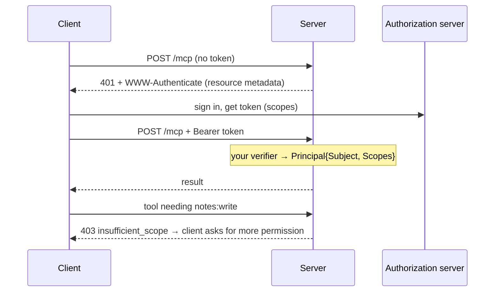

# Authentication

**What for:** know who calls and limit what they may do. Optional. Example: [auth.go](../example/auth.go).
gomcp is only a *resource server*: it verifies tokens, it never issues them (that is the authorization server's job).

## Use it

```go
// @MCP.Auth(type="oauth", resource="https://notes.example.com/mcp")
// @MCP.AuthServer("https://auth.example.com")
// @MCP.AuthScope("notes:read", description="Read notes", default)
func VerifyToken(ctx context.Context, token string) (mcp.Principal, error) { ... }

// @MCP.Tool("add_note")
// @MCP.AuthScopes("notes:write")
```



| `type` | Behaviour |
|---|---|
| `none` (default) | no auth; keep to localhost + `@MCP.AllowedOrigin` |
| `bearer` | verifier only; failure = plain `401` (API keys, internal tokens) |
| `oauth` | metadata endpoint, `401` + challenge, audience check, `403 insufficient_scope`; needs `resource=`, `@MCP.AuthServer`, `@MCP.AuthScope` |

| Annotation | Target | Meaning |
|---|---|---|
| `@MCP.Auth(type=, resource=)` | verifier func | declares a scheme; several allowed, first success wins |
| `@MCP.AuthServer(url)` | verifier func | `authorization_servers` in the metadata |
| `@MCP.AuthScope(name, description, default)` | verifier func | declares a scope; `default` is requested in the challenge |
| `@MCP.AuthScopes("a","b")` | any feature | scopes needed to call it, checked against `Principal.Scopes` |

The verifier shape is `func(ctx context.Context, token string) (mcp.Principal, error)`. In a handler,
`ctx.Principal()` is the caller; use `Subject` for per-user data (rate limits, ownership). Tasks and
`requestState` are bound to it too.
