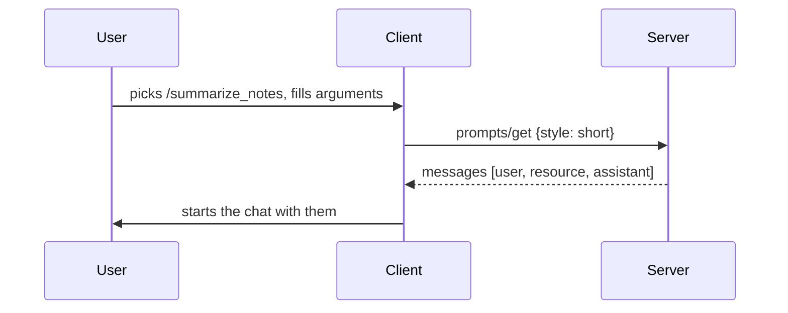
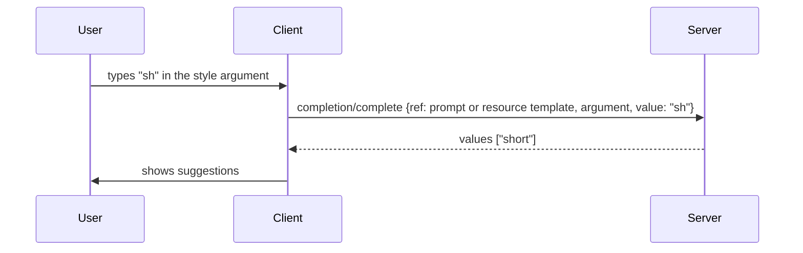

# Prompts

**What for:** reusable conversation starters the *user* picks, like a slash command with arguments. A prompt returns
messages, optionally with resources already embedded.
Example: [prompts_completion.go](../example/prompts_completion.go).

## Use it

```go
// @MCP.Prompt("summarize_notes", title="Summarize note")
func SummarizeNotes(ctx mcp.Context, a SummarizeArgs) (mcp.Messages, error) { ... }
```



| Annotation | Meaning |
|---|---|
| `@MCP.Prompt("name", title, description)` | declares the prompt; arguments = input struct fields (required unless `omitempty` / pointer) |
| `@MCP.AuthScopes`, `@MCP.Icon`, `@MCP.Meta`, `@MCP.Use` | scopes, icon, `_meta`, middleware |

Handler: `func(ctx mcp.Context, in In) (mcp.Messages, error)`. Build messages with `mcp.UserText`, `mcp.User`
(or a `mcp.Message` literal for other roles); content can be text, image, audio or an embedded resource (`mcp.EmbedResource`).

# Completion

**What for:** autocomplete while the user fills in an argument. It is a separate feature from prompts: it suggests
values for a **prompt argument** *or* a **resource template variable** (`note:///{id}`).



| Annotation | Meaning |
|---|---|
| `@MCP.Complete(arg=, values=)` on a prompt | fixed suggestions for one argument |
| `@MCP.Complete(for=, arg=)` on a func | computed suggestions; `for` = prompt name **or** resource URI template |

```go
// @MCP.Complete(for="note:///{id}", arg="id")
func CompleteID(ctx mcp.Context, partial string, resolved map[string]string) (mcp.Completion, error) { ... }
```

Handler: `func(ctx mcp.Context, partial string, resolved map[string]string) (mcp.Completion, error)`. `partial` is
what was typed, `resolved` the arguments already filled in. Return `mcp.Completion{Values, Total, HasMore}` or
`mcp.Values(...)` (at most 100 values are sent).
