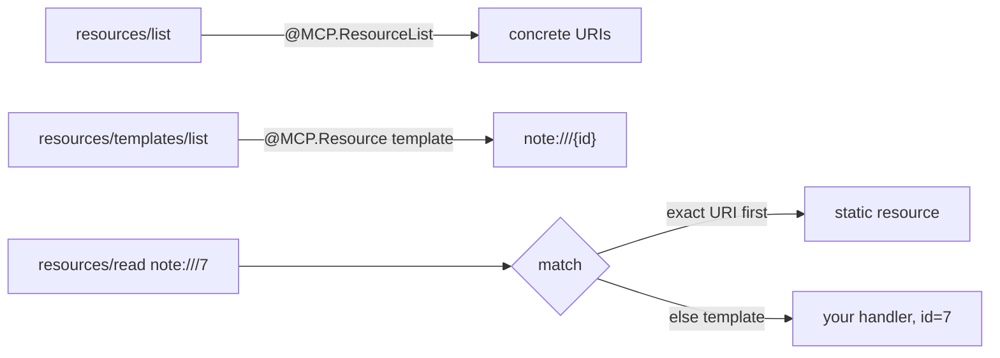
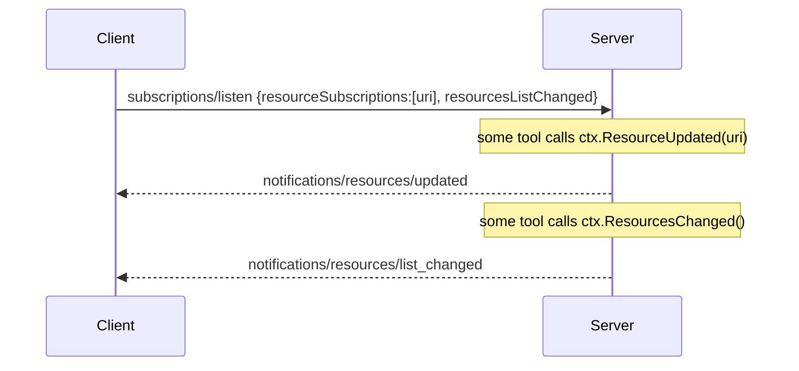

# Resources

**What for:** give the client data to *read*: files, records, reports. The app (or user) picks them, not the model.
Example: [resources.go](../example/resources.go).

## Use it

```go
// @MCP.Resource("note:///{id}", title="Note", mime="text/plain")
// @MCP.Subscribable
func Read(ctx mcp.Context, u NoteURI) (mcp.Contents, error) { ... }   // NoteURI{ID string `uri:"id"`}
```



| Annotation | Meaning |
|---|---|
| `@MCP.Resource("uri-or-template", title, mime, description)` | fixed URI or RFC 6570 template; `{id}` binds to a `uri:"id"` field |
| `@MCP.ResourceList("template")` | lists concrete URIs for `resources/list` (page with `mcp.Paginate`) |
| `@MCP.Subscribable` | clients may watch it for changes |
| `@MCP.Annotations(audience, priority, lastModified)` | hints for the client |
| `@MCP.AuthScopes`, `@MCP.Icon`, `@MCP.Meta`, `@MCP.Use` | scopes, icon, `_meta`, middleware |

Handlers: template `func(ctx mcp.Context, uri URI) (mcp.Contents, error)`, static `func(ctx mcp.Context) (mcp.Contents, error)`, list `func(ctx mcp.Context, page mcp.PageReq) (mcp.Page[mcp.ResourceRef], error)`.

Template variables can be autocompleted, see [Completion](prompts.md#completion).

Contents: `mcp.TextContent`, `mcp.JSONContents`. Not found: `mcp.ErrNotFound` →
`-32602` with `data.uri`.

## Telling clients about changes

There is no server push channel. A client that wants updates opens `subscriptions/listen` and names what it cares
about (`resourceSubscriptions`, `resourcesListChanged`, `toolsListChanged`, `promptsListChanged`, `taskIds`). The stream
is acknowledged first and stays open until the client closes it or the server stops.


