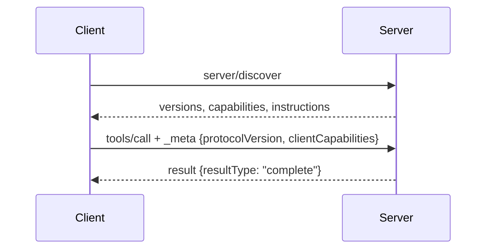
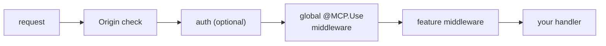
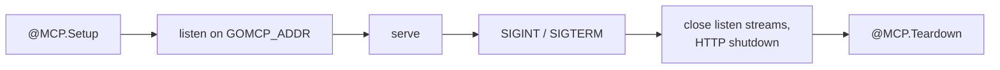

# Server, transport, lifecycle

**What for:** describe the server (name, instructions for the model), tune the HTTP side, and hook into start and
stop. Package-level annotations; they can sit in any comment block in the package.
Example: [server_transport.go](../example/server_transport.go), [middleware.go](../example/middleware.go), [lifecycle.go](../example/lifecycle.go), [static_assets.go](../example/static_assets.go).

```go
// @MCP.Server("notes", title="Notes MCP Example", version="1.0.0")
// @MCP.Instructions("Use the notes tools to create and read short text notes.")
// @MCP.Endpoint("/mcp")
// @MCP.Cache("5m", scope="private")
package api
```

## Stateless by design

No session and no `initialize`: every request names its protocol version and the client's capabilities, so any
instance can answer it and nothing needs sticky routing. A client may call `server/discover` first to learn versions,
capabilities and instructions.



Headers `Mcp-Protocol-Version`, `Mcp-Method`, `Mcp-Name` mirror the body so gateways can route without parsing it;
a mismatch is `-32020`, an unknown version `-32022`. Discover, list and read results carry cache hints (`@MCP.Cache`).

## Request path



## Identity (`server/discover` result)

| Annotation | Meaning |
|---|---|
| `@MCP.Server("name", title, version, description, website, baseURL)` | `serverInfo` |
| `@MCP.Icon(src, mime, sizes, theme)` | server icon; also valid on any feature |
| `@MCP.Instructions("...")` | `instructions`; hints the client may add to the LLM system prompt |

## Transport

| Annotation | Meaning |
|---|---|
| `@MCP.Endpoint("/mcp")` | single endpoint; POST only (GET and DELETE answer `405`) |
| `@MCP.AllowedOrigin("...")` (repeatable) | `Origin` check, `403` otherwise |
| `@MCP.KeepAlive("30s")` | keep-alive comments on `subscriptions/listen` streams |
| `@MCP.PageSize(n)` | page size for every list operation |
| `@MCP.Cache("5m", scope="public\|private")` | `ttlMs` / `cacheScope` hints of `server/discover`, list and read results |

The server is stateless: there are no sessions, so nothing to configure for them. Set `GOMCP_STATE_KEY` when several
instances serve one endpoint, so each can verify the `requestState` the other issued.

## Middleware

Wraps every call, for logging, metrics, rate limits. `@MCP.Middleware` on a func declares it; `@MCP.Use(fn)` attaches it, at package level
(all features) or on a single feature. Same shape for tools, resources, prompts and completion:
`func(ctx mcp.Context, req mcp.Request, next mcp.Handler) (any, error)`.

## Lifecycle



`@MCP.Setup` / `@MCP.Teardown` on funcs run once on server start / stop: `func() error` / `func()`.

## Static assets and icons

`@MCP.ServeAssets("/assets")` on an `embed.FS` var makes the server serve those files (mime from extension, caching headers).
`@MCP.Icon("assets/add.svg")` with a relative path resolves to the served URL (base from request host or `@MCP.Server(baseURL=)`); absolute URLs stay as is.
Any file type works; icons use it for `src` / `mimeType` / `sizes`.

## Listening

The generated server listens on `GOMCP_ADDR` (default `:8080`); `gomcp serve --addr` sets it. It stops on
`SIGINT` / `SIGTERM`: open listen streams are completed, the HTTP server shuts down, then `@MCP.Teardown` runs.
