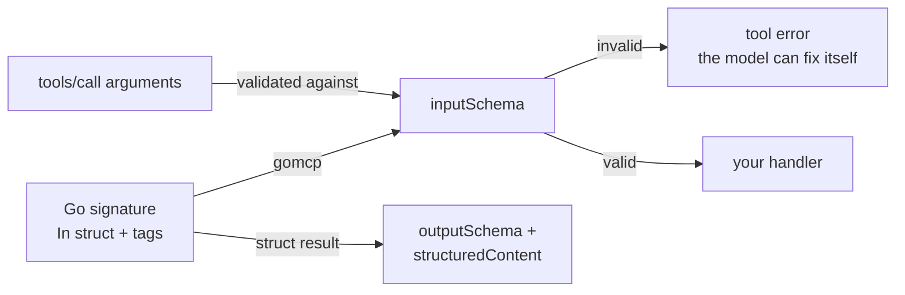
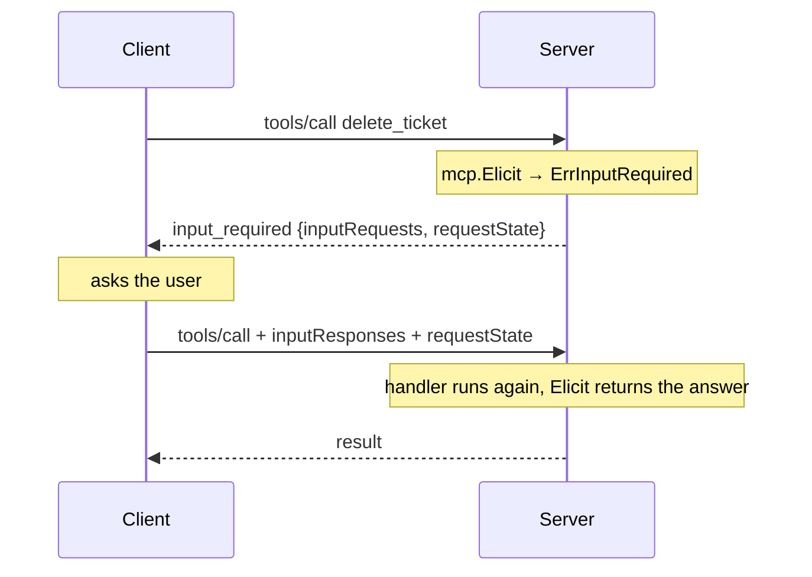
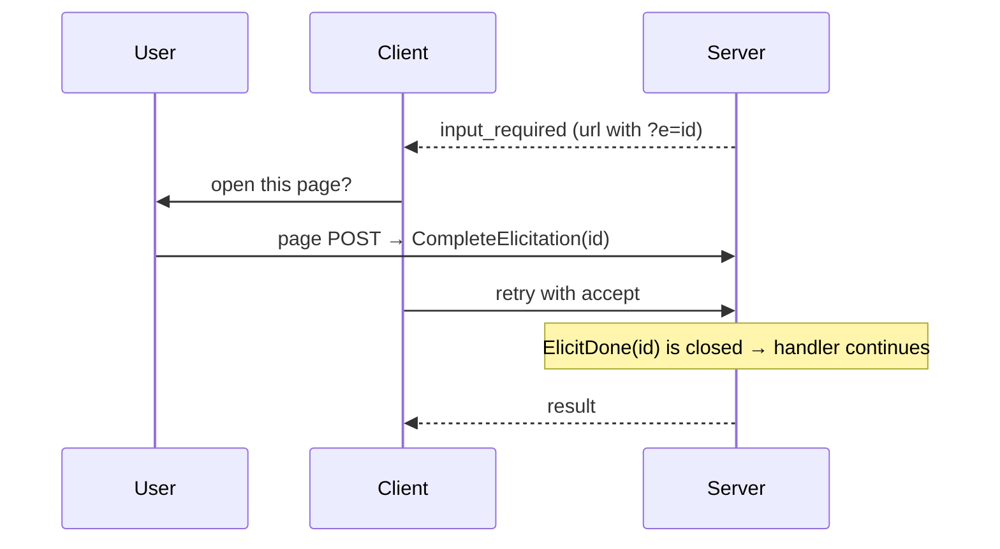
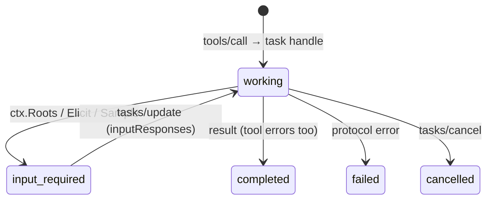

# Tools

**What for:** let the model *do* something: create a ticket, run a query, send a mail.
Examples: [tools.go](../example/tools.go), [elicitation.go](../example/elicitation.go), [sampling.go](../example/sampling.go), [task_import.go](../example/task_import.go).

## Use it

```go
// @MCP.Tool("get_note", description="Returns a note by id")
// @MCP.Hint(readOnly, idempotent)
// @MCP.AuthScopes("notes:read")
func Get(ctx mcp.Context, in IDIn) (mcp.Result[Note], error) { ... }
```



| Annotation | Meaning |
|---|---|
| `@MCP.Tool("name", title, description)` | declares the tool |
| `@MCP.Hint(readOnly, destructive, idempotent, openWorld)` | hints for the client (it may ask the user before destructive calls) |
| `@MCP.Requires(sampling, elicitation[="url"], roots)` | client capabilities needed; otherwise `-32021` before the handler runs |
| `@MCP.Task(optional\|required, ttl, poll)` | may run as a background task |
| `@MCP.AuthScopes`, `@MCP.Icon`, `@MCP.Meta(k="v")`, `@MCP.Use(fn)` | scopes, icon, `_meta`, middleware |

Handler: `func(ctx mcp.Context, in In) (Out, error)`. Struct tags: `desc enum min max default format`; required = no `omitempty` and not a pointer.
`header:"Name"` on a top-level field also sends that argument as header `Mcp-Param-Name` (for gateways).

## Results and errors

| Return | Client sees |
|---|---|
| struct | `structuredContent` + text |
| string / number / slice | text |
| `mcp.Result[T]` | structured value + your content (`mcp.Text`, `mcp.ResourceLink`, ...) |
| `mcp.ToolError(msg)` or any `error` | `isError: true`, the **model** sees the message |
| `mcp.ErrInvalidParams(msg)` | JSON-RPC error, the **client** sees it |

## Asking the user or the client's model

| Need | Call |
|---|---|
| Confirmation, follow-up question (form) | `mcp.Elicit[T](ctx, msg)` → `(T, action, err)` |
| Send the user to a web page (sign-in, payment) | `ctx.ElicitURL(msg, url)` + `ctx.ElicitDone(id)` |
| Ask the client's LLM | `ctx.Sample(req)` |
| Read the client's project roots | `ctx.Roots()` |

The server never calls the client. These calls return `mcp.ErrInputRequired` until the client has answered:
**return it unchanged**. gomcp sends `input_required` (questions + a signed `requestState`), the client answers and
retries, and your handler runs **again from the top** with the answers available.



Ask first, do side effects after. Set `GOMCP_STATE_KEY` when several instances serve one endpoint.

```go
ans, action, err := mcp.Elicit[ConfirmDelete](ctx, "Delete "+in.ID+"?")
if err != nil {
	return mcp.Empty{}, err // ErrInputRequired: gomcp asks, then runs the handler again
}
if action != mcp.Accept || !ans.Confirm {
	return mcp.Empty{}, mcp.ToolError("kept")
}
```

**URL elicitation** sends the user to *your* web page. That page's backend calls `mcp.CompleteElicitation(id)`;
the waiting handler continues. Approving early is fine: the result is remembered until it expires.



## Long-running tasks

Extension `io.modelcontextprotocol/tasks`. With `@MCP.Task` the **server** decides: a client that declared the
extension gets a task handle at once, others get the result directly (`required` tools answer `-32021`).



The client polls `tasks/get`, answers with `tasks/update`, cancels with `tasks/cancel`, or follows `taskIds` via
`subscriptions/listen`. Use `ctx.Progress(cur, total, msg)` and watch `ctx.Done()` for cancellation. Tasks belong to
their caller and are kept `ttl` after they finish.
