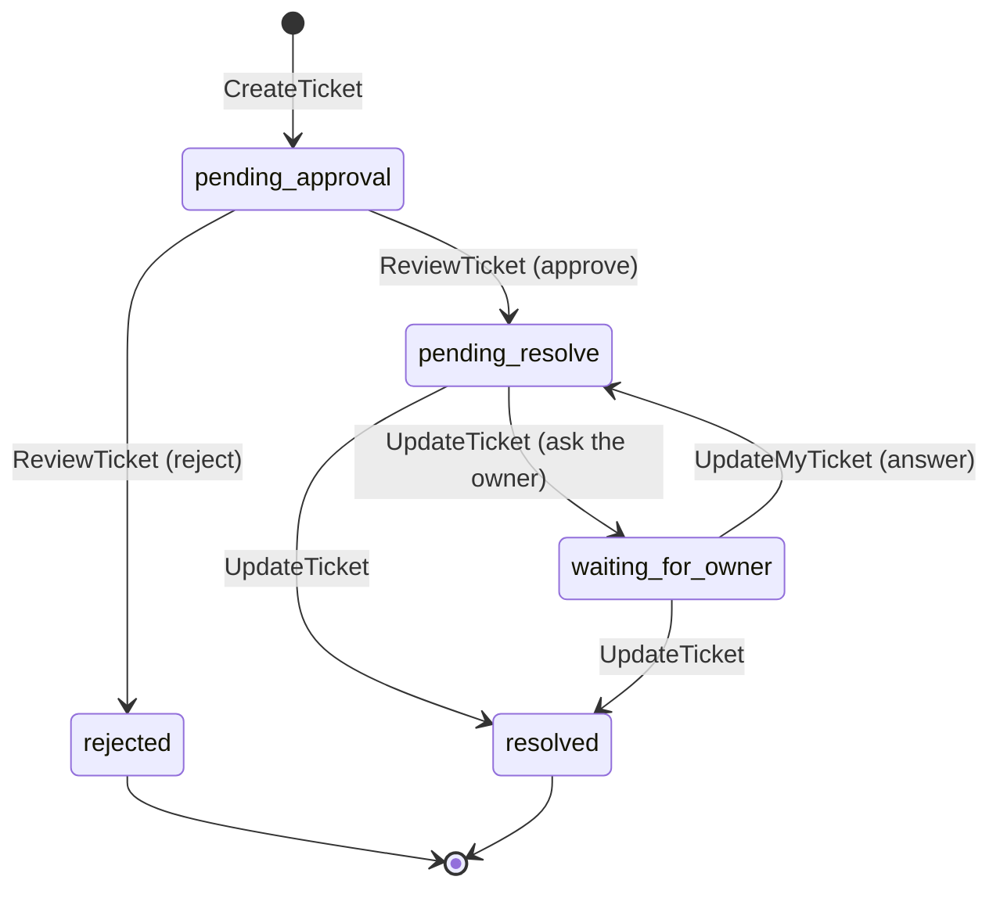

# ESM (Enterprise Service Management) MCP

A ticket desk as an MCP server. Users file requests and incidents, a reviewer approves them, ops process them. It shows what a closer-to-real gomcp server looks like:

- **Authentication with Microsoft Entra ID.** Tokens are verified against Entra's keys, the Entra app roles become scopes, and every tool names the scope it needs (`@MCP.AuthScopes`).
- **A human confirms every change.** Tools show a draft and ask the user to confirm (`@MCP.Requires(elicitation)`, `mcp.Elicit`) before anything is written.
- **Users see only their own data.** The owner comes from the token, never from the tool arguments.
- **A state machine** for the life of a ticket, kept out of the handlers.
- **Configuration from the environment** (`env.example`), `Setup` and `Teardown`.
- **Tests at every level:** rules on their own, tools through a real server, and a whole ticket life end to end.

## Tickets



- Nobody reviews their own ticket, and the review list leaves a reviewer's own tickets out.
- Ops only process approved tickets.
- The owner can add information in any open status. Only an answer in `waiting_for_owner` changes the status.
- `rejected` and `resolved` are final.

## Tools

| Tool               | Description                                  | Role     | Arguments                                   |
| ------------------ | -------------------------------------------- | -------- | ------------------------------------------- |
| CreateTicket       | create a new ticket                          | user     | type!, description!                         |
| ListOwnTickets     | list own tickets                             | user     | status?, id?                                |
| UpdateMyTicket     | add information or answer ops                | user     | id!, message!                               |
| ListPendingReviews | list tickets that wait for my review         | reviewer |                                             |
| ReviewTicket       | approve or reject a ticket                   | reviewer | id!, result!, reason!                       |
| UpdateTicket       | add a note, ask the owner or resolve         | ops      | id!, message!, status!                      |

Every role is also a user: a valid token always holds `esm:user`, and the `roles` claim adds `esm:ops` and `esm:reviewer`. The write tools ask the user to confirm a draft first.

Not implemented: attachments.

## Structure

- `doc.go`: the server name and the instructions for the model.
- `auth.go`: Entra token verification and the role-to-scope mapping.
- `ticket_service.go`: the rules. `transitions` is the state machine, `TicketService` checks a change (`Plan*`) and writes it (`Commit`). It knows nothing about MCP.
- `storage.go`: the `TicketRepository` interface (persistence only, `AppendJournal` is a compare and set) and the in-memory version.
- `tool_*.go`: thin handlers. They build the caller from the token, call `Plan*`, ask the user to confirm, then `Commit`.

## Run

```sh
cp env.example .env      # tenant, audience, public URL
gomcp serve .            # from this directory; add --addr to expose it
go test ./...
```

Without the Entra settings every token is rejected, but `gomcp stdio .` works locally because stdio has no authentication.
